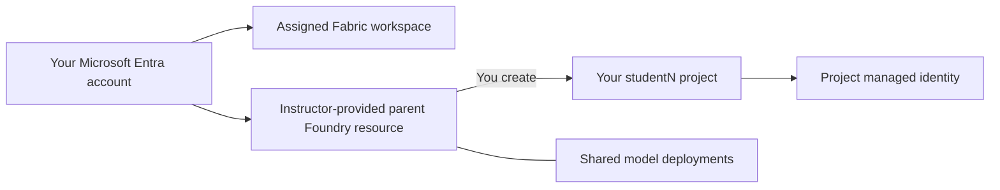

# Lab 00 — Sign in and create a project

[Contents](./README.md) · [Japanese](../jp/lab-00-setup.ja.md)

**Time: 10 minutes | Output: Your `studentN` Foundry project**

## 1. Get the details from the instructor

Get your student number `N`, training account, Fabric workspace name, parent Foundry resource name and **Azure portal Overview link**, shared Azure AI Search service name, and chat and embedding deployment names. Keep the [English lab data](./data/README.md) on your computer. Use your credentials on the designated sign-in screen and enter only lab messages in chat.

## 2. Sign in to Fabric and the Azure portal

1. Sign in to the [Fabric portal](https://app.fabric.microsoft.com/) with your training account. If your regular account is selected automatically, use a separate browser profile or private window.
2. Select **Workspaces** in the left navigation, then your assigned workspace. Match the workspace name at the top and look for **New item** above the item list.
3. In another tab in the same browser session, open the instructor's **Azure portal** link. On the parent Foundry resource's **Overview**, confirm the resource name.

## 3. Create your project

1. In the Azure portal, select **Resource Management → Projects** in the parent resource's left navigation. Select **New** above the list.
2. Enter `studentN` (for example, `student03`) in **Name** and select **Create**. Wait for `studentN` to appear in the same parent's **Projects** list.
3. Tell the instructor your project name and continue directly to Lab 01 in the Fabric tab. During Labs 01–03, the instructor sets up the permissions for Labs 04 and 05. You open the Foundry portal in Lab 04.

**Checkpoint:** You confirmed your assigned Fabric workspace and the `studentN` project you created in the assigned parent's **Azure portal** list.

[Official UI: Add a project to an existing parent in the Azure portal](https://learn.microsoft.com/en-us/azure/foundry-classic/how-to/migrate-project?tabs=azure) · [Next: Lab 01](./lab-01-data.en.md)
