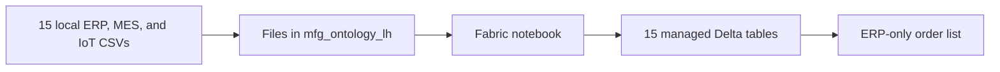

# Lab 01 — Load data into a lakehouse



[Contents](./README.md) · [Japanese](../jp/lab-01-data.ja.md)

**Time: 20 minutes | Output: 15 managed Delta tables in `mfg_ontology_lh`**

## Starting screen: Your Fabric workspace item list

Sign in to the [Fabric portal](https://app.fabric.microsoft.com/) with your training account. In the left navigation, select **Workspaces**, then the workspace assigned by your instructor. Match the workspace name at the top and look for **New item** above the item list. Return to this list even if you already have a different item open.

## 1. Create the lakehouse and upload the English CSV files

1. Above the item list, select **New item → Lakehouse**. Enter `mfg_ontology_lh` in **Name**, confirm that **Location** is your workspace, and select **Create**. Wait for the new lakehouse to open.
2. On the lakehouse ribbon, select **Get data → Upload files**. In the upload pane, select the folder icon, open the downloaded `en` folder, and follow the relative paths below to select the `.en.csv` files. Keep the filenames unchanged.

   | Folder | Files to upload | Data overview |
   | --- | --- | --- |
   | ERP: [`./data/erp/`](./data/erp/) | 7 CSVs | Customer, product, material, and supplier master data, bills of materials (BOMs), and sales and purchase orders. Use these files to check order values and planned ship dates. |
   | MES: [`./data/mes/`](./data/mes/) | 5 CSVs | Production lines, equipment, material lots, work orders, and quality inspection results. Use these files to trace equipment and lots through work orders to sales orders. |
   | IoT: [`./data/iot/`](./data/iot/) | 3 CSVs | A sensor registry, time-series readings such as temperature, vibration, and vacuum pressure, and equipment alerts. Use these files to see which equipment reported an anomaly and when. |

3. For each folder, select **Upload** to place its CSVs directly under **Files**. Select **Files** in the left **Explorer** pane and confirm that it contains all 15 files at that level.

## 2. Create the tables and record the ERP baseline

1. On this lakehouse's ribbon, select **Open notebook → New notebook**. Note the new notebook's name for the Lab 03 extension. Before running the cells, check that the left pane shows the default pin next to `mfg_ontology_lh`.
2. Paste the Python below into the first code cell. Set `data_language = "en"`, then select the triangular **Run** button to the left of the cell. Wait for Spark to start and for all 15 table counts to appear below the cell.

   ```python
   from pyspark.sql import functions as F
   from pyspark.sql.types import IntegerType

   data_language = "ja"
   csv_suffix = {"ja": ".csv", "en": ".en.csv"}[data_language]

   counts = {
       "erp_bom": 18, "erp_customers": 10, "erp_materials": 12,
       "erp_products": 6, "erp_purchase_orders": 16, "erp_sales_orders": 24,
       "erp_suppliers": 8, "mes_equipment": 15, "mes_material_lots": 18,
       "mes_production_lines": 6, "mes_quality_inspections": 24,
       "mes_work_orders": 30, "iot_equipment_alerts": 10, "iot_sensors": 15,
       "iot_telemetry": 360,
   }

   for table, expected in counts.items():
       if not spark.catalog.tableExists(table):
           source = spark.read.options(
               header=True, inferSchema=True, mode="FAILFAST"
           ).csv(f"Files/{table}{csv_suffix}")
           fields = [
               F.col(f.name).cast("string").alias(f.name) if f.name.endswith("_id")
               else F.col(f.name).cast("long").alias(f.name) if isinstance(f.dataType, IntegerType)
               else F.col(f.name)
               for f in source.schema
           ]
           source.select(*fields).write.format("delta").option(
               "delta.columnMapping.mode", "none"
           ).saveAsTable(table)
       actual = spark.table(table).count()
       if actual != expected:
           raise ValueError(f"{table}: expected {expected} rows, got {actual}")
       print(f"{table}: {actual}")
   ```

   If a count differs, check that the CSV for the table in the error is directly under **Files**, and verify `data_language` and the default lakehouse. The cell checks the counts of existing tables and imports the tables still to be created.
3. Hover below the first cell and select **Code** to add a second cell. Paste the SQL below, including the `%%sql` line, and select **Run** on the new cell.

   ```sql
   %%sql
   SELECT COUNT(*) AS order_count, SUM(order_amount_jpy) AS exposure_jpy
   FROM erp_sales_orders
   WHERE order_id IN ('SO-2026-004', 'SO-2026-009')
     AND order_status_code = 3;
   ```

   Check `order_count = 2` and `exposure_jpy = 80500000`. Record the initial list for the meeting: **2 orders, JPY 80,500,000**, for `SO-2026-004` and `SO-2026-009`.

**Checkpoint:** Back in the workspace item list, select the `mfg_ontology_lh` lakehouse row. **Explorer → Tables** shows 15 tables (under `dbo` if schemas are enabled). For example, `erp_sales_orders` has 24 rows, `mes_work_orders` 30, and `iot_telemetry` 360. In `erp_customers`, `CUS-003` is `Kansai Semiconductor Equipment Co., Ltd.`.

[Official UI: Upload files](https://learn.microsoft.com/en-us/fabric/onelake/quickstart-get-data) · [Notebooks and the default lakehouse](https://learn.microsoft.com/en-us/fabric/data-engineering/lakehouse-notebook-explore) · [Next: Lab 02](./lab-02-ontology.en.md)
