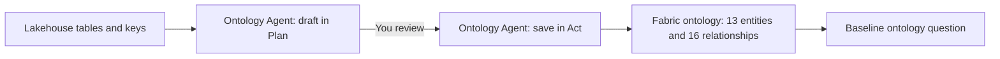

# Lab 02 — Build the Fabric ontology



[Contents](./README.md) · [Japanese](../jp/lab-02-ontology.ja.md)

**Time: 25 minutes | Output: `studentN_mfg_ontology` and a before-enrichment answer**

## Starting screen: Your Fabric workspace item list

In the [Fabric portal](https://app.fabric.microsoft.com/), select **Workspaces** in the left navigation, then your assigned workspace. This lab uses the 15 tables you created in `mfg_ontology_lh` in [Lab 01](./lab-01-data.en.md).

## 1. Create the ontology

1. Select **New item** above the workspace list, type `ontology` in the item catalog search box, and select **Ontology (preview)** in the results.
2. In **Name**, append `_mfg_ontology` to the `studentN` project name you created in Lab 00. For example, enter `student03_mfg_ontology` for project `student03`. Confirm that **Location** is your workspace and select **Create**.
3. When the empty canvas opens, check that the title matches the name you entered. Note the ontology name and browser URL for Labs 03 and 05.

**Why use a student-specific name?** Foundry derives the connection name from the ontology's display name. Connection names can collide under the same Foundry parent even when projects and Fabric workspaces are separate, so start the ontology name with your project name.

## 2. Bind data and relationships

**How to read the prompt:** An ontology models the things a business works with, such as orders and equipment, and how they relate. Here you connect those business terms to the data loaded in Lab 01. In step 2, send only the code block.

- **Type, table, and key:** `SalesOrder = erp_sales_orders (order_id)` tells the agent to connect the `SalesOrder` entity type to the `erp_sales_orders` table and use `order_id` to identify each sales order. The connection to the table is a **binding**; the field that identifies a record is a **key**. The fields on a type, such as its ID or quantity, are its **properties**.
- **Relationship and direction:** `fulfillsSalesOrder: WorkOrder.sales_order_id -> SalesOrder.order_id` tells the agent to match the work order's `sales_order_id` to the sales order's `order_id`. For example, work order `WO-2026-1001` has `SO-2026-001` in `sales_order_id`, so you can follow it to the sales order with that ID. Use these two columns directly to create the relationship.
- **Scope:** Define entity types from the 13 tables listed below and create 16 relationships. Draft the definition in **Plan** and save it in **Act**. The lakehouse serves as the data source.

1. On the new canvas, choose **Start with Ontology agent** to open the chat pane on the right.
2. Select **Plan** below the chat input. Paste the base ontology prompt below into the input and send it.

   ```text
   Draft the base ontology using only mfg_ontology_lh in the current workspace.
   Use the default namespace. Bind the columns using their original names and set the indicated entity keys.
   Do not change source data. Leave namespaces, synonyms, extra metadata and business rules for Lab 03.
   Use direct column joins without a mapping table for fulfillsSalesOrder, processedByEquipment, and consumesMaterialLot.

   Entity = table (key):
   Customer = erp_customers (customer_id)
   Supplier = erp_suppliers (supplier_id)
   Material = erp_materials (material_id)
   Product = erp_products (product_id)
   SalesOrder = erp_sales_orders (order_id)
   PurchaseOrder = erp_purchase_orders (po_id)
   ProductionLine = mes_production_lines (line_id)
   Equipment = mes_equipment (equipment_id)
   MaterialLot = mes_material_lots (material_lot_id)
   WorkOrder = mes_work_orders (order_id)
   QualityInspection = mes_quality_inspections (inspection_id)
   Sensor = iot_sensors (sensor_id)
   EquipmentAlert = iot_equipment_alerts (alert_id)

   Relationship: source foreign key -> target key:
   placedByCustomer: SalesOrder.customer_id -> Customer.customer_id
   ordersProduct: SalesOrder.product_id -> Product.product_id
   fulfillsSalesOrder: WorkOrder.sales_order_id -> SalesOrder.order_id
   producesProduct: WorkOrder.product_id -> Product.product_id
   scheduledOnLine: WorkOrder.line_id -> ProductionLine.line_id
   processedByEquipment: WorkOrder.equipment_id -> Equipment.equipment_id
   consumesMaterialLot: WorkOrder.material_lot_id -> MaterialLot.material_lot_id
   locatedInLine: Equipment.line_id -> ProductionLine.line_id
   lotOfMaterial: MaterialLot.material_id -> Material.material_id
   suppliedByVendor: MaterialLot.supplier_id -> Supplier.supplier_id
   primarySupplier: Material.primary_supplier_id -> Supplier.supplier_id
   backupSupplier: Material.backup_supplier_id -> Supplier.supplier_id
   inspectedForWorkOrder: QualityInspection.work_order_id -> WorkOrder.order_id
   triggeredOnEquipment: EquipmentAlert.equipment_id -> Equipment.equipment_id
   monitoredBySensor: Sensor.equipment_id -> Equipment.equipment_id
   poToSupplier: PurchaseOrder.supplier_id -> Supplier.supplier_id
   ```

3. **Review the draft before applying it.** In the right-hand chat, select the preview action in the agent's reply. On the canvas, verify that the draft has 13 entities and 16 relationships bound to `mfg_ontology_lh`. Check that the three relationships named in the table in step 5 each start at `WorkOrder` and connect to the listed target. Request any corrections in **Plan** and review the new preview. You will check the join columns after applying the draft, in step 5.
4. Apply the reviewed draft: select **Act** below the same input and send “Apply the reviewed draft.” Wait for the definition in the left **Explorer** pane, then switch back to **Plan**.
5. **Verify the saved join columns.** Match the relationship configuration saved in Fabric to the column names in the table below.

   1. On the ontology ribbon, select **Home**. In the center of the canvas, select the `fulfillsSalesOrder` line that connects `WorkOrder` to `SalesOrder`.
   2. In the [relationship configuration](https://learn.microsoft.com/en-us/fabric/iq/ontology/how-to-create-relationship-types#edit-or-delete-relationship-type), confirm that **Use mapping table** is off. Check that **Property 1** on the origin side is `sales_order_id` and **Property 1** on the target side is `order_id`.
   3. Select **Cancel** to close. For each of the other two relationships, return to **Home**, select its line, compare **Property 1** on both sides with the table below, and close with **Cancel**.

   | Relationship name | Origin entity and join column | Target entity and join column |
   | --- | --- | --- |
   | `fulfillsSalesOrder` | `WorkOrder.sales_order_id` | `SalesOrder.order_id` |
   | `processedByEquipment` | `WorkOrder.equipment_id` | `Equipment.equipment_id` |
   | `consumesMaterialLot` | `WorkOrder.material_lot_id` | `MaterialLot.material_lot_id` |

   `WorkOrder.order_id` identifies the work order itself. Use `WorkOrder.sales_order_id` to link it to a sales order.

   If a setting does not match the table, open the chat with **Home → Ontology agent**. In **Plan**, specify the relationship name and the correct columns. Review the new preview, apply it as in step 4, and repeat this check.

## 3. Record the before-enrichment answer

“Before enrichment” means the tables and relationships are in place, before you add synonyms, status-code descriptions, and a business rule in Lab 03. Note which type the agent uses for work orders and sales orders and which data it uses as evidence.

If the right-hand chat pane is closed, select **Home → Ontology agent** on the ribbon. Keep **Plan** selected and send the question below. Record the answer and the entity names used to compare with the enriched model in Lab 03.

```text
Distinguish the work orders on quality hold on Hamamatsu Line 2 from the sales orders they fulfill. If ERP has not recorded a delivery risk, show the IDs that support your finding.
```

**Checkpoint:** Verify that **Explorer** shows `SalesOrder` and `WorkOrder` bound to their tables and that the saved join columns for all three relationships match the table. Record the baseline answer and compare it with the enriched answer and its evidence in Lab 03.

[Official UI: Create an ontology](https://learn.microsoft.com/en-us/fabric/iq/ontology/tutorial-1-create-ontology) · [Ontology Agent](https://learn.microsoft.com/en-us/fabric/iq/ontology/how-to-use-ontology-agent) · [Next: Lab 03](./lab-03-impact.en.md)
