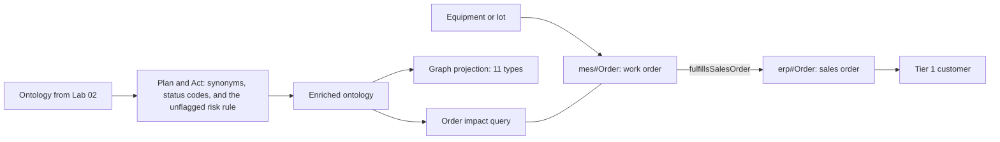

# Lab 03 — Add business context and trace impact



[Contents](./README.md) · [Japanese](../jp/lab-03-impact.ja.md)

**Time: 30 minutes | Output: An enriched ontology and an evidence-backed impacted order list**

## Starting screen: The ontology saved in Lab 02

In the [Fabric portal](https://app.fabric.microsoft.com/), select **Workspaces** in the left navigation and select your assigned workspace. From the item list, select your `studentN_mfg_ontology` by the name you noted in [Lab 02](./lab-02-ontology.en.md). This lab adds business context to that ontology.

## 1. Distinguish ERP orders from MES orders

**How to read the prompt:** Lab 02 defined which data to use and how it connects. This lab keeps those connections and tells the agent how to interpret the fields, the status codes, and the conditions for a delivery risk.

1. **Namespaces and synonyms:** `erp#Order` represents a customer sales order in ERP; `mes#Order` represents a factory work order in the manufacturing execution system (MES). The part before `#` is the **namespace** and the part after it is the type name. The namespaces distinguish two types called `Order`. **Synonyms** such as “sales order” and “work order” give users other ways to refer to the corresponding type. Update the two types you created in Lab 02.
2. **Status code descriptions:** For example, `3` in a sales order's `order_status_code` means `AtRisk`, while `3` in an inspection's `disposition_code` means `ScrapHold`. Record the meaning of each source code in the corresponding property description.
3. **Business rule:** For an in-scope Tier 1 customer order, the risk is unflagged when all three conditions hold: ERP is `InProduction` (`2`), either MES or inspection shows the relevant hold, and the combined good quantity across all linked work orders is below the ordered quantity. For example, for an order of 10 units, two work orders with 6 and 2 good units leave a shortage of 2. Check the ERP status and the hold as well, and use the three conditions as evidence for the classification.

On the canvas ribbon, select **Home → Ontology agent**. In the right-hand chat pane, select **Plan** below the input, then paste and send only the code block below.

```text
Draft these changes while retaining all 13 entities, 16 relationships, keys, and table bindings. Do not update source data.
1. Rename the existing SalesOrder type to Order and assign it to the erp namespace (erp#Order). Set its synonyms to "sales order", "customer order", and "SO". Rename the existing WorkOrder type to Order and assign it to the mes namespace (mes#Order). Set its synonyms to "work order", "work instruction", and "job". Retain fulfillsSalesOrder from mes#Order.sales_order_id to erp#Order.order_id. Leave the namespaces of the other entities unchanged.
2. In the property descriptions, document 2=InProduction and 3=AtRisk for erp#Order.order_status_code, 30=QualityHold for mes#Order.wo_status_code, and 3=ScrapHold for QualityInspection.disposition_code.
3. Add HiddenErpOrderRiskEscalation and link it to erp#Order and mes#Order. For an in-scope Tier 1 order, when ERP is still 2, a linked MES QualityHold or inspection ScrapHold and a combined good quantity below the order quantity indicate a delivery risk not yet flagged in ERP.
```

### Review and apply the draft

1. **Before applying:** Select the preview action in the right-hand chat reply. On the read-only canvas, check that ERP and MES have separate `Order` types connected by `fulfillsSalesOrder`. Verify that the remaining entity types and relationships match the Lab 02 model. If the draft differs from the request, ask for a correction in **Plan** and open the new preview.
2. **Apply:** When the draft is ready, select **Act** below the chat input and send “Apply the reviewed changes.” Wait for the changes to appear in the left **Explorer** pane and return to **Plan**. Use the following steps to read the saved table bindings, synonyms, descriptions, and rule definition.

### Verify the saved settings

After applying the draft, verify the saved namespaces of the two existing types in **Explorer**. If `SalesOrder` or `WorkOrder` still appears in the default namespace, check the apply result in chat and use the preceding steps to update the existing types.

1. **Namespaces, source tables, and synonyms:** In **Explorer** on **Home**, select **…** to the right of **Filter by name**, then select **Namespaces** under **Group by**. Expand `erp` and `mes` and check the type in each group. Select the type, then select **Entity type → Open details** on the ribbon. On **Configure**, check the type name and **Namespace** in **Details**. In **Properties**, compare **Data source** for the `order_id` row with the table below. Scroll down to **Entity metadata**, select **Edit**, and read the **Synonyms**. Select **Cancel** to close. Select **Home** at the top and repeat for the type in the other group.

   | Namespace and type | Data source for `order_id` | Synonyms |
   | --- | --- | --- |
   | `Order` in `erp` (`erp#Order`) | `erp_sales_orders.order_id` | `sales order`, `customer order`, `SO` |
   | `Order` in `mes` (`mes#Order`) | `mes_work_orders.order_id` | `work order`, `work instruction`, `job` |

2. **Status code descriptions:** Return to **Home** and select the relevant entity type. On the canvas, select **…** next to its name, then **Bind data**. Select **Entity type properties** below the source list in the left pane. Select **Metadata** on the row for the property shown below. Compare its **Description** with the expected codes, then select **Cancel** to close. Repeat for all three properties.

   | Entity type | Property to open | Expected status codes in the description |
   | --- | --- | --- |
   | `erp#Order` | `order_status_code` | `2=InProduction`, `3=AtRisk` |
   | `mes#Order` | `wo_status_code` | `30=QualityHold` |
   | `QualityInspection` | `disposition_code` | `3=ScrapHold` |

3. **Relationship:** Return to **Home** and select the `fulfillsSalesOrder` line on the canvas. Check that the origin type is `mes#Order` with `sales_order_id` under **Property 1**, and the target type is `erp#Order` with `order_id` under **Property 1**. Select **Cancel**.
4. **Business rule:** On **Home**, expand **Rules** in **Explorer** and select `HiddenErpOrderRiskEscalation`. Confirm that both `Order` types appear under **Linked ontology elements**. Read the **Definition**: for an in-scope Tier 1 order, ERP must be `2`, either MES must be `30` or the inspection must be `3`, and the sum of `good_qty` for the linked work orders must be less than the sales order's `order_qty`. When all those conditions are met, the order counts as a delivery risk not yet flagged in ERP.

If a setting differs, open the **Plan** chat with **Home → Ontology agent** and specify the affected entity type, property, relationship, or rule and its expected setting. Review the new preview, apply it, and reopen the affected setting to verify it before continuing.

## 2. Retrieve order impact through the ontology

The question starts with the equipment or material lot, finds the work orders, and follows the relationships from Lab 02 to the sales orders and customers. The status meanings and rule from Lab 03 distinguish risks already flagged in ERP from unflagged ones. If both paths lead to the same sales order, count it only once in the order count and total value.

Return to **Home**. If the right-hand chat pane is closed, select **Ontology agent** on the ribbon. Keep **Plan** selected and paste and send the question below. Record the query language used (SQL, KQL, or GQL) and check that the answer uses the ontology's relationships and status descriptions as evidence.

```text
For the 2026-05-14 snapshot, trace EQ-VBF-204 or LOT-MAG-088 through work orders to sales orders and Tier 1 customers. Include orders with MES QualityHold or inspection ScrapHold that ERP already flags as at risk, or that have insufficient good quantity and aren't flagged in ERP. Show work order IDs, ERP and MES status codes, and whether the risk is unflagged. Deduplicate by sales order ID and report the total order value and daily late-delivery penalty per customer and in total.
```

**Checkpoint:** `SO-2026-004`, `SO-2026-009`, and `SO-2026-015`: **3 orders, JPY 99,700,000, JPY 2,350,000/day**. `SO-2026-015` has ERP `2=InProduction`, but `WO-2026-1019` has MES `30=QualityHold` and insufficient good quantity, so the risk is unflagged. Explain what changed from the two-order list in Lab 01. Compare the answer with Lab 02 and check that the enriched model makes the evidence clear.

## 3. Inspect the relationships in a graph

1. On the ribbon of the same ontology canvas, select **Home → Manage → Graph**. In **Review validation**, wait for the results and select **Select entities**.
2. In **Choose what to project**, deselect `PurchaseOrder` and `Sensor`, keeping the other 11 types and their relationships. Use **Preview** to check the path from equipment or lot through work order and sales order to customer. Select **Continue**, review **Projection summary**, and select **Materialize**.
3. Check **Materialization status** for a completed data load or refresh and record it separately from the ontology query in section 2. If the graph is still loading after the allotted time, record “graph load pending” and continue to Lab 04.

## Extension (+15 min): Graph exploration and SQL cross-check

After the graph loads, return to your workspace list using **Workspaces** in the left navigation. Select the graph model created in section 3 whose name starts with `studentN_mfg_ontology_graph_`, then select **Query → Query now** on the graph model ribbon to explore the path.

### Cross-check order IDs and totals in the notebook

In the [Fabric portal](https://app.fabric.microsoft.com/), select **Workspaces**, choose your workspace, and select your Lab 01 notebook by name. Check that `mfg_ontology_lh` is the default. Hover below the last cell, select **Code**, paste the SQL below including the `%%sql` line, and select **Run** on that cell.

```sql
%%sql
WITH incident_orders AS (
    SELECT DISTINCT w.sales_order_id
    FROM mes_work_orders w
    WHERE (w.equipment_id = 'EQ-VBF-204' OR w.material_lot_id = 'LOT-MAG-088')
      AND (w.wo_status_code = 30 OR EXISTS (
          SELECT 1
          FROM mes_quality_inspections q
          WHERE q.work_order_id = w.order_id AND q.disposition_code = 3
      ))
),
good_quantity AS (
    SELECT sales_order_id, SUM(good_qty) AS available_qty
    FROM mes_work_orders
    GROUP BY sales_order_id
)
SELECT s.order_id, s.order_status_code, s.order_amount_jpy,
       c.customer_id, c.sla_penalty_jpy_per_day,
       COUNT(*) OVER () AS affected_orders,
       SUM(s.order_amount_jpy) OVER () AS total_exposure_jpy
FROM incident_orders i
JOIN erp_sales_orders s ON i.sales_order_id = s.order_id
JOIN erp_customers c ON s.customer_id = c.customer_id
JOIN good_quantity g ON g.sales_order_id = s.order_id
WHERE c.customer_tier = 'Tier1'
  AND (s.order_status_code = 3
       OR (s.order_status_code = 2 AND g.available_qty < s.order_qty))
ORDER BY s.order_id;
```

**Expected:** `SO-2026-004`, `SO-2026-009`, `SO-2026-015`; **3 orders, JPY 99,700,000**. Read the grand total from `total_exposure_jpy` on any one row.

Use Lakehouse SQL to cross-check the results. Verify ontology retrieval in section 2 and Foundry integration with the response and trace in Lab 06.

[Official UI: Entity type details](https://learn.microsoft.com/en-us/fabric/iq/ontology/how-to-view-ontology-details) · [Business rules and metadata](https://learn.microsoft.com/en-us/fabric/iq/ontology/tutorial-2-enrich-ontology) · [Graph configuration](https://learn.microsoft.com/en-us/fabric/iq/ontology/how-to-use-ontology-graph) · [Next: Lab 04 after the break](./lab-04-knowledge.en.md)
