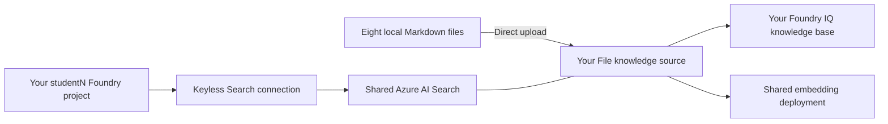

# Lab 04 — Upload documents and configure Foundry IQ

[Contents](./README.md) · [Japanese](../jp/lab-04-knowledge.ja.md)

**Time: 25 minutes | Output: A connection to shared Search, `ks-studentN-mfg-ops`, and `kb-studentN-mfg-ops`**

## Starting screen: Your Foundry project

1. Open the parent resource's **Azure portal** link from [Lab 00](./lab-00-setup.en.md). Select **Resource Management → Projects** and select the `studentN` project you created.
2. On `studentN`'s **Overview**, select **Go to Foundry portal**. Turn on **New Foundry** and check that `studentN` appears in the upper-left. Bookmark this Foundry project URL for Labs 05 and 06.

## 1. Connect your project to the shared Search service

1. In `studentN`, select **Manage** in the top bar and **Project details** in the left navigation. Open **Connections** beside **Users**, then select **Add connection → Azure AI Search → Continue**.
2. In **Create a new connection**, keep **Browse** selected. Open the **Azure AI Search** list and select the service named by the instructor. Under **Auth Type**, select **Project Managed Identity**, then select **Connect**.
3. Note the new name in **Connections** for Lab 05. Select **Build** in the top bar and **Knowledge** in the left navigation. Select the connection you just created from **Connection** above the knowledge-base list. On the shared service, use only the knowledge base with your student number.

## 2. Create a file knowledge source

1. Select **Create a knowledge base** above the list and enter `kb-studentN-mfg-ops` under **Basic configuration → Name**. Keep **Improve retrieval** at its default **Minimal** setting.
2. In **Knowledge sources (Foundry IQ)**, select **Upload files**. In the downloaded `en` folder, open [`./data/unstructured_docs/`](./data/unstructured_docs/) and select only the eight `.en.md` files listed below with their original filenames and contents. Use the document IDs to check citations in later labs.

   | Filename | Document ID | What it covers |
   | --- | --- | --- |
   | [`GLOSSARY_enterprise_domain_terms.en.md`](./data/unstructured_docs/GLOSSARY_enterprise_domain_terms.en.md) | `DOC-GLOSSARY` | Interview notes on how teams use terms such as “order,” plus synonyms, status codes, and measurement units. |
   | [`INC-2026-1028_hamamatsu_line2_brazing_incident.en.md`](./data/unstructured_docs/INC-2026-1028_hamamatsu_line2_brazing_incident.en.md) | `DOC-INC-1028` | Historical 8D investigation of vacuum seal degradation and brazed-joint voids on Hamamatsu Line 2, for reference on the past investigation and countermeasures. |
   | [`MAN-MAT-NDFEB_magnet_lot_handling.en.md`](./data/unstructured_docs/MAN-MAT-NDFEB_magnet_lot_handling.en.md) | `DOC-MAN-NDFEB` | Moisture limits for neodymium magnets at receipt and before use, and when to recondition or return a lot or switch to a qualified backup supplier. |
   | [`POL-SCM-002_emergency_expedite_and_airfreight.en.md`](./data/unstructured_docs/POL-SCM-002_emergency_expedite_and_airfreight.en.md) | `DOC-POL-SCM002` | When to escalate delivery risk, how to prioritize transfers, alternative sourcing, and expedited transport, and who approves emergency measures. |
   | [`QMS-STD-004_actuator_quality_disposition.en.md`](./data/unstructured_docs/QMS-STD-004_actuator_quality_disposition.en.md) | `DOC-QMS-004` | Acceptance criteria for torque ripple, brazed-joint voids, and insulation resistance, including when to rework, quarantine, or block shipment. |
   | [`SLA-CUS-001_tier1_robotics_contract_summary.en.md`](./data/unstructured_docs/SLA-CUS-001_tier1_robotics_contract_summary.en.md) | `DOC-SLA-TIER1` | Tier 1 customer terms for late-delivery penalties, initial 8D reporting triggers and deadlines, and equipment or material substitutions. |
   | [`SOP-EQ-CNC-101_spindle_vibration_maintenance.en.md`](./data/unstructured_docs/SOP-EQ-CNC-101_spindle_vibration_maintenance.en.md) | `DOC-SOP-CNC101` | CNC-101 calibration intervals, restrictions on assigning work when calibration is overdue, and steps for responding to abnormal spindle vibration. |
   | [`SOP-EQ-VBF-204_vacuum_brazing_furnace.en.md`](./data/unstructured_docs/SOP-EQ-VBF-204_vacuum_brazing_furnace.en.md) | `DOC-SOP-VBF204` | Operating limits for vacuum brazing furnaces VBF-204 and VBF-205, first actions for abnormal temperature or pressure, and conditions for restarting or switching furnaces. |

3. In the source creation form that follows the file picker, enter `ks-studentN-mfg-ops` and confirm the assigned **Embedding model**. Leave **Content extraction mode** at its default **Minimal** and select **Create**.
4. When the `ks-studentN-mfg-ops` row shows eight files, select **Save knowledge base** at the top. For `429`, wait for the time shown and select **Retry** only on the failed files.

**Checkpoint:** Before starting Lab 05, confirm that the saved knowledge base includes this lab's **File** source and that its file list shows all eight files as **Ready**. If you see a `403` or the upload action is missing, check that you selected your own project and the Search connection you created in section 1.

[Official guide: Direct file uploads](https://learn.microsoft.com/en-us/azure/search/agentic-knowledge-source-how-to-file) · [Connection UI](https://learn.microsoft.com/en-us/azure/foundry/how-to/connections-add) · [Next: Lab 05](./lab-05-agent.en.md)
