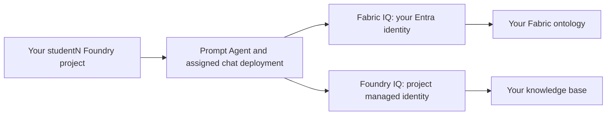

# Lab 05 — Connect the Foundry agent



[Contents](./README.md) · [Japanese](../jp/lab-05-agent.ja.md)

**Time: 30 minutes | Output: `mfg-shipment-advisor-studentN` and traces for both tools**

## Starting screen: The tools list in your Foundry project

Open the Foundry project URL you bookmarked in [Lab 04](./lab-04-knowledge.en.md) and confirm that `studentN` appears in the upper-left. Select **Build** in the top bar, **Tools** in the left navigation, and the **Tools** tab above the list. This lab connects `studentN_mfg_ontology` from Lab 03 and `kb-studentN-mfg-ops` from Lab 04, with all eight documents ready.

## 1. Connect the ontology

1. Above the tools list, select **Connect a tool**. In the tool picker, select the **Fabric IQ (OneLake Catalog)** card, then **Add tool** at the bottom.
2. In the OneLake Catalog, use **Filter** to select **Ontology** and deselect the default **Semantic model**. Search for the name you noted in Lab 02, such as `student03_mfg_ontology`. Select only the row that matches both your ontology name and your assigned workspace, then select **Add** at the bottom. If your item is missing, check the search name and filter.
3. Select the new connection in the tools list. In its details, compare the item ID immediately after `/items/` in **Remote MCP server endpoint** with the ID immediately after `/ontologies/` in the URL you noted in Lab 02. They must match. Confirm that **Authentication** is **OAuth Identity Passthrough** (your Microsoft Entra user), then note the connection name shown in the tools list for the next section.

## 2. Attach both connections to the agent

1. Select **Agents** in the **Build** left navigation and select **New agent → Build an agent** above the list. Enter `mfg-shipment-advisor-studentN` in **Agent name**. Keep **Text** selected and leave **Use the Microsoft Copilot harness** off. Select **Create agent and open playground**.
2. In the new agent's **Playground**, choose the assigned deployment under **Model**. Open **Add** in the **Tools** section, keep **Web search** off, and select **Add tools**. Choose the connection you made in section 1 on the **Configured** tab and select **Add tool**.
3. Expand **Knowledge** on the left and select **Add → Connect to Foundry IQ**. Under **Connection**, choose the Search connection name you noted in Lab 04. Under **Knowledge base**, choose `kb-studentN-mfg-ops`, then select **Connect**. Check that **Tools** and **Knowledge** show their respective connections.
4. Expand **Instructions** in the left settings pane and paste the following into its text box. Select **Save** at the top and check that the saved version appears.

```text
Help review shipment decisions for Hamamatsu Line 2. Use only the 2026-05-14 workshop snapshot and answer in English. Use Fabric IQ for data-only questions and Foundry IQ for document-only questions. Call both for shipment decisions or the exact initial 8D deadline for a specific case.

Fabric IQ: Trace affected equipment or lots through work orders to sales orders and Tier 1 customers. Include orders with MES 30 (QualityHold) or inspection 3 (ScrapHold) and either ERP 3 (AtRisk), or ERP 2 (InProduction) with combined good quantity below the order quantity. Label only ERP 3 as flagged in ERP; label qualifying ERP 2 as risk not yet flagged in ERP. Deduplicate order value by sales order ID and count the potential daily delay penalty once per customer. Show sales order, work order, and customer IDs with separate ERP and MES states.

For incident impact, make focused Fabric IQ calls. Treat 2026-05-14 as the snapshot label, not a filter on row dates. First get mes#Order rows where equipment_id or material_lot_id matches the incident. Request order_id, sales_order_id, wo_status_code, and good_qty. Do not filter this first lookup by ERP status or customer tier. Then use the returned sales order IDs to get order_status_code, order_qty, and order_amount_jpy from erp#Order and customer_id, customer_tier, and sla_penalty_jpy_per_day from Customer. Use these exact column names; the Tier 1 code is Tier1. If a required field is missing from a joined result, query its entity by ID. Check disposition_code and combined good_qty across linked work orders when needed, then apply the risk rule and calculate totals from the retrieved values.

Foundry IQ: Search policies, SOPs, and SLAs by equipment, material, and customer IDs. Give the applicable condition with a document ID or filename and a citation. Apply the approval policy to the Fabric IQ order total. Report order value (JPY) and the daily penalty (JPY/day) separately; do not add them or treat order value as a loss. Use the SLA's trigger event and duration for each customer.

Initial 8D: For CUS-003, the trigger is the MES QualityHold entry for the affected work order. Calculate an exact deadline only if that MES entry's timestamp is available. Never substitute an inspection time, equipment alert time, scheduled time, or snapshot date. If the timestamp is missing, state “The exact deadline cannot be calculated,” and cite the SLA condition and the record that must be checked.

Separate facts, document evidence, recommendations, and open questions. Do not treat failed retrieval as no impact; state what evidence is missing. Do not write to systems, approve, order, release shipments, or notify customers.
```

## 3. Check each connection separately

In the saved agent's **Playground**, select **Chat** on the right. For each question, select **New chat** at the top and paste only the code block under **Message to send** into **Message the agent...**. Select **Send** at the right of the message box. After the answer finishes, select **Traces** beneath it and expand **Response** to inspect the tool calls. Close the trace pane and select **New chat** again before sending question 2.

### Question 1: Verify affected orders with Fabric IQ

**Message to send:**

```text
Use only Fabric IQ to list the Tier 1 sales orders affected by EQ-VBF-204 or LOT-MAG-088 in the 2026-05-14 workshop snapshot, including any risk not yet flagged in ERP.
Show one entry per sales order ID with its ERP status code and whether the risk is flagged in ERP. For unflagged orders, also show the supporting work order ID, MES status code, good quantity, and order quantity.
```

**Expected answer:**

- `SO-2026-004` and `SO-2026-009` are flagged in ERP with status `3 (AtRisk)`.
- `SO-2026-015` is still at ERP status `2 (InProduction)`, so its risk is unflagged. Work order `WO-2026-1019` is at MES status `30 (QualityHold)`, with 15 good units against 40 ordered.
- Check that the trace shows a successful `ask_ontology` call and that the answer uses the returned results.

### Question 2: Verify the approval policy and SLA with Foundry IQ

**Message to send:**

```text
Use only Foundry IQ. In DOC-POL-SCM002, what thresholds for total affected sales order value and incremental emergency cost require COO approval?
For CUS-003, what event starts the clock for the initial 8D report, and how many hours are allowed? Give the document ID and quote the relevant passage for both the policy and the SLA. Do not calculate an incident order total or an exact deadline.
```

**Expected answer:**

- `DOC-POL-SCM002`: COO approval is required if the total affected order value is **at least JPY 90,000,000 or** the incremental emergency cost is **at least JPY 3,000,000**.
- `DOC-SLA-TIER1`: The initial 8D report for `CUS-003` is due **within 24 hours** of the MES record of `QualityHold` (code `30`).
- Check that the trace shows a successful `knowledge_base_retrieve` call and that the answer cites the relevant passages in both documents.

**Checkpoint:** Open the `ask_ontology` output for Question 1 and the `knowledge_base_retrieve` output for Question 2. Continue to Lab 06 when each answer matches that evidence. If an issued call succeeds but the answer classifies the result incorrectly, compare the evidence, check and save the instructions, and retry in a fresh chat. If prompted to approve a call, verify the connection and read operation first.

**Extension (+15 min):** Compare document retrieval when you use only shop-floor language and when you supply equipment and customer IDs. Check whether the citations support the decision.

[Official UI: Fabric IQ tool](https://learn.microsoft.com/en-us/azure/foundry/agents/how-to/tools/fabric-iq) · [Connect Foundry IQ](https://learn.microsoft.com/en-us/azure/foundry/agents/how-to/foundry-iq-connect) · [Next: Lab 06](./lab-06-review.en.md)
