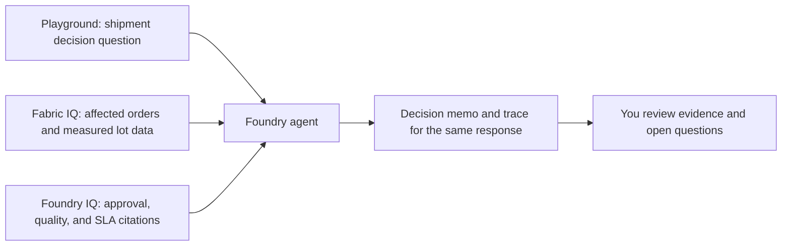

# Lab 06 — Review the shipment decision



[Contents](./README.md) · [Japanese](../jp/lab-06-review.ja.md)

**Time: 30 minutes | Output: A one-page decision memo and the trace of both tools**

## Starting screen: The Playground for your agent

Open the Foundry project URL you bookmarked in [Lab 04](./lab-04-knowledge.en.md) and confirm that `studentN` appears in the upper-left. Select **Build** in the top bar and **Agents** in the left navigation. Open the `mfg-shipment-advisor-studentN` agent you created in [Lab 05](./lab-05-agent.en.md). Select **Playground**, then **Chat** on the right. Check **Version** against the version you saved with both connections in Lab 05.

## 1. Create the decision memo and check its evidence

In the right-hand chat pane, select **New chat** above the conversation. Paste only the code block into **Message the agent...** at the bottom, then select **Send** on the right of the input.

**Message to send:**

```text
Prepare a shipment decision memo for the impact of EQ-VBF-204 or LOT-MAG-088 on Hamamatsu Line 2.
Use Fabric IQ to retrieve the affected Tier 1 orders, including unflagged risks, deduplicated order value, daily late-delivery penalties, and the measured moisture (moisture_ppm) for LOT-MAG-088. If the lot value is missing, query it separately.
Use Foundry IQ to retrieve and cite the expedited handling approval policy, containment and substitution conditions, and each customer's initial 8D trigger event and time allowance.
Apply only the deduplicated order value to the approval policy's order-value threshold. Compare the measured moisture with the policy threshold. Separate facts, document evidence, recommendations, and open questions.
Organize the memo in this order: affected orders and amounts; emergency handling approval; quality actions and alternatives; initial 8D and open questions.
```

**Open the trace for this response:** Select **Traces** directly beneath the answer. Expand the **Response** for this question and confirm that Fabric IQ's `ask_ontology` and Foundry IQ's `knowledge_base_retrieve` both completed successfully. Select each call to compare its returned values or documents with the memo using the table below. If a tool was called more than once, use the relevant outputs together. Match citations by document ID or filename.

**Expected answer and evidence to check:**

| Memo section | What to check in the answer | Evidence to check in the trace |
| --- | --- | --- |
| Affected orders and amounts | `SO-2026-004` and `SO-2026-009` are flagged in ERP at `3 (AtRisk)`. `SO-2026-015` is still at ERP `2 (InProduction)` but `WO-2026-1019` is at MES `30 (QualityHold)`, with 15 good units against 40 ordered, so the risk is **unflagged in ERP**. The memo shows **JPY 99,700,000** in order value and **JPY 2,350,000/day** in potential penalties separately. | Check the order IDs, statuses, quantities, order values, and daily penalties by customer from `ask_ontology`. Count order value once per order ID and daily penalties once per customer. Compare the two totals separately. |
| Emergency handling approval | The **JPY 99,700,000 order total** meets the threshold of **JPY 90,000,000 or more**, so **COO approval is required**. Present emergency handling as a proposal pending approval. | Compare the order values from `ask_ontology` and the COO approval condition from `DOC-POL-SCM002` returned by `knowledge_base_retrieve`. |
| Quality actions | Propose quarantining the affected work and returning all of `LOT-MAG-088`: its measured **182 ppm** exceeds the **175 ppm** return threshold. | Compare the lot's `moisture_ppm` from `ask_ontology` with the return condition in `DOC-MAN-NDFEB` from `knowledge_base_retrieve`. The quality standard or equipment procedure supports quarantine. |
| Alternatives | Identify qualified `SUP-007`/`LOT-MAG-091` as candidates. If recovery will take **12 hours or more** and Tier 1 orders are affected, verify that `EQ-VBF-205` has current calibration, pressure of **2.0 Pa or lower**, and an available slot before requesting a transfer. List air freight, ordering, and shipment release as pending decisions. | Look for the qualified alternatives in `DOC-MAN-NDFEB` and the transfer conditions in `DOC-SOP-VBF204` from `knowledge_base_retrieve`. |
| Initial 8D and open questions | `CUS-001` and `CUS-002`: **within 48 hours of detection**. `CUS-003`: **within 24 hours of the MES quality-hold entry**. Separate confirmed facts from details to verify, such as the start time and equipment availability. | Check the applicable customer clauses in `DOC-SLA-TIER1` from `knowledge_base_retrieve`: compare both the time allowance and the event that starts the clock. |

### Combining Fabric IQ and Foundry IQ

The emergency approval decision shows how the tools work together. **Fabric IQ provides the facts about this incident. Foundry IQ provides the rule for the decision.** The Foundry agent calls both tools and brings their evidence together in one answer.

- **Fabric IQ finds the affected orders.** `ask_ontology` uses the ontology relationships to trace equipment `EQ-VBF-204` or material lot `LOT-MAG-088` through work orders to sales orders and customers. `SO-2026-015` is still in production in ERP, but its work order `WO-2026-1019` is on quality hold, with 15 good units against 40 ordered. That makes it an affected order.
- **Foundry IQ finds the approval rule.** `knowledge_base_retrieve` locates the emergency handling policy `DOC-POL-SCM002` in the knowledge base. It returns the condition that COO approval is required when the total affected order value is at least JPY 90,000,000.
- **The Foundry agent applies the rule to this case.** The initial ERP list in [Lab 01](./lab-01-data.en.md) had two orders worth JPY 80,500,000, which falls in the VP of Supply Chain band if additional costs are below JPY 3,000,000. Adding `SO-2026-015` at JPY 19,200,000 brings the total to JPY 99,700,000 across three orders. The memo compares that total with the JPY 90,000,000 threshold and explains why **COO approval is required** on order value alone.

The same approach applies to the material lot. The agent compares the **182 ppm measurement** from Fabric IQ with the **above-175-ppm return condition** from `DOC-MAN-NDFEB`, retrieved by Foundry IQ, and recommends returning the lot. Together, the two tools provide the evidence needed to recommend **what to do in this case and why**.

**Explain what changed in your own words:** Use the trace for this same response to explain which order was added, which approval threshold the agent cited, and what decision followed when it applied the threshold to the order total.

## 2. Check the exact 8D deadline in a new chat

Check whether the agent can calculate an exact deadline and identify the record needed to calculate it. Close the trace pane, select **New chat**, paste only the code block into **Message the agent...**, and select **Send**.

**Message to send:**

```text
What is the exact date and time of the initial 8D deadline for CUS-003 in the current case (WO-2026-1019)?
```

**Expected answer:**

- Cite `DOC-SLA-TIER1`: the report is due **within 24 hours** of the MES record of `QualityHold` (code 30).
- `WO-2026-1019` is on quality hold. The training data establishes the hold status only, so report that **the exact deadline cannot be calculated**. Identify the record needed to calculate it: the MES quality-hold event timestamp for this work order.

**Checkpoint:** Confirm that both tools succeed in the same response in section 1 and that the memo matches their evidence. Explain what changed and identify the record needed to calculate the deadline in section 2. If a response misses a criterion, check the retrieved evidence and the agent's instructions, then resend only the message in the code block in a new chat.

**Extension (+20 min):** Ask whether queued `WO-2026-1025` on `EQ-CNC-101` can start. Compare its calibration age of 95 days with the 90-day interval in `DOC-SOP-CNC101` and verify the recommendation to hold Tier 1 work. Record this as a separate case from Hamamatsu Line 2.

[English workshop documents](./data/unstructured_docs/) · [Contents](./README.md)
