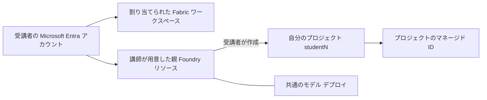

# Lab 00 — サインインとプロジェクト作成

[目次](./README.md) · [English](../en/lab-00-setup.en.md)

**所要時間：10分｜成果物：自分の Foundry プロジェクト `studentN`**

## 1. 講師から受け取るもの

受講者番号 `N`、研修アカウント、Fabric ワークスペース名、親 Foundry リソースの名前と **Azure ポータルの概要へのリンク**、共通 Azure AI Search のサービス名、応答・埋め込みモデルのデプロイ名を受け取ります。[日本語の教材データ](./data/README.md)を手元に置きます。資格情報は指定のサインイン画面で使い、チャットには演習用メッセージだけを入力します。

## 2. ポータルにサインインする

1. [Fabric ポータル](https://app.fabric.microsoft.com/)に研修アカウントでサインインします。普段のアカウントが自動で選ばれる場合は、別のブラウザー プロファイルかプライベート ウィンドウを使います。
2. 左ナビゲーションの **ワークスペース** を選び、表示された一覧から講師指定の名前を選びます。上部に自分のワークスペース名があり、項目一覧の上に **新しい項目** が表示されることを確認します。
3. 同じブラウザー セッションの別タブで、講師から受け取った **Azure ポータル** のリンクを開きます。親 Foundry リソースの **概要** に、講師指定のリソース名が表示されていることを確認します。

## 3. 自分のプロジェクトを作る

1. Azure ポータルの親リソースの左メニューで **リソース管理 → プロジェクト** を選びます。一覧上部の **新規** を選びます。
2. **名前** に `studentN`（例：`student03`）を入力し、**作成** を選びます。作成が完了し、同じ親リソースの **プロジェクト** 一覧に `studentN` が表示されるまで待ちます。
3. プロジェクト名を講師に伝え、Fabric のタブでそのまま Lab 01 に進みます。講師は Lab 01〜03 の間に、Lab 04・05 で使う権限を設定します。受講者が Foundry ポータルを開くのは Lab 04 です。

**チェックポイント：** 自分の Fabric ワークスペースと、**Azure ポータル** の指定された親リソースの一覧に自分で作成した `studentN` を確認しました。

[公式画面：Azure ポータルで既存の親にプロジェクトを追加](https://learn.microsoft.com/ja-jp/azure/foundry-classic/how-to/migrate-project?tabs=azure) · [次：Lab 01](./lab-01-data.ja.md)
