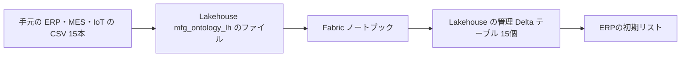

# Lab 01 — Lakehouseにデータを取り込む



[目次](./README.md) · [English](../en/lab-01-data.en.md)

**所要時間：20分｜成果物：`mfg_ontology_lh` の管理 Delta テーブル15個**

## 開始画面：自分の Fabric ワークスペースの項目一覧

[Fabric ポータル](https://app.fabric.microsoft.com/)に研修アカウントでサインインし、左ナビゲーションの **ワークスペース** から講師指定の名前を選びます。画面上部のワークスペース名を照合し、項目一覧の上に **新しい項目** があることを確認します。別の項目を表示中の場合も、この一覧に戻ってから始めます。

## 1. レイクハウスを作り、元CSVをアップロードする

1. 項目一覧の上部で **新しい項目 → レイクハウス** を選びます。**名前** に `mfg_ontology_lh` を入力し、**場所** が自分のワークスペースであることを確認して **作成** を選びます。新しいレイクハウスの画面が表示されるまで待ちます。
2. レイクハウスの上部リボンで **データの取得 → ファイルのアップロード** を選びます。アップロード画面でフォルダーのアイコンを選び、ダウンロードした `jp` フォルダーから下表の相対パスをたどります。配布時のファイル名のまま、CSVを選びます。

   | フォルダー | アップロードするもの | データの概要 |
   | --- | --- | --- |
   | ERP：[`./data/erp/`](./data/erp/) | CSV 7本 | 顧客・製品・材料・仕入先のマスター、部品表（BOM）、受注・発注。受注額や出荷予定を確認するために使います。 |
   | MES：[`./data/mes/`](./data/mes/) | CSV 5本 | 生産ライン、設備、材料ロット、製造指図、品質検査結果。設備やロットから、関連する製造指図と受注をたどります。 |
   | IoT：[`./data/iot/`](./data/iot/) | CSV 3本 | センサー台帳、温度・振動・真空圧などの時系列の計測値、設備アラート。どの設備で、いつ異常が報告されたかを確認します。 |

3. フォルダーごとに **アップロード** を選び、CSVを **ファイル** の直下に登録します。左の **エクスプローラー** で **ファイル** を選び、直下に15本そろったことを確認します。

## 2. テーブルを作り、ERPの初期リストを確認する

1. このレイクハウスの上部リボンで **ノートブックを開く → 新しいノートブック** を選びます。Lab 03 の発展課題で使うので、作成されたノートブックの名前を控えます。左側で `mfg_ontology_lh` の横に既定を示すピンが付いていることを確認してから、セルを実行します。
2. 最初のコード セルに下のPythonを貼り付けます。`data_language = "ja"` のまま、セル左側の三角形の **実行** を選びます。初回の Spark 起動を待ち、セル下に15テーブルの件数が出たことを確認します。

   ```python
   from pyspark.sql import functions as F
   from pyspark.sql.types import IntegerType

   data_language = "ja"
   csv_suffix = {"ja": ".csv", "en": ".en.csv"}[data_language]

   counts = {
       "erp_bom": 18, "erp_customers": 10, "erp_materials": 12,
       "erp_products": 6, "erp_purchase_orders": 16, "erp_sales_orders": 24,
       "erp_suppliers": 8, "mes_equipment": 15, "mes_material_lots": 18,
       "mes_production_lines": 6, "mes_quality_inspections": 24,
       "mes_work_orders": 30, "iot_equipment_alerts": 10, "iot_sensors": 15,
       "iot_telemetry": 360,
   }

   for table, expected in counts.items():
       if not spark.catalog.tableExists(table):
           source = spark.read.options(
               header=True, inferSchema=True, mode="FAILFAST"
           ).csv(f"Files/{table}{csv_suffix}")
           fields = [
               F.col(f.name).cast("string").alias(f.name) if f.name.endswith("_id")
               else F.col(f.name).cast("long").alias(f.name) if isinstance(f.dataType, IntegerType)
               else F.col(f.name)
               for f in source.schema
           ]
           source.select(*fields).write.format("delta").option(
               "delta.columnMapping.mode", "none"
           ).saveAsTable(table)
       actual = spark.table(table).count()
       if actual != expected:
           raise ValueError(f"{table}: expected {expected} rows, got {actual}")
       print(f"{table}: {actual}")
   ```

   件数が不一致なら、エラーに出たテーブルの CSV が **ファイル** の直下にあること、`data_language`、既定のレイクハウスを確認します。このセルは作成済みテーブルの件数を照合し、未作成のテーブルを取り込みます。
3. 最初のセルの下にポインターを置き、**コード** を選んで別セルを追加します。下のSQLを `%%sql` の行から貼り付け、新しいセルの **実行** を選びます。

   ```sql
   %%sql
   SELECT COUNT(*) AS order_count, SUM(order_amount_jpy) AS exposure_jpy
   FROM erp_sales_orders
   WHERE order_id IN ('SO-2026-004', 'SO-2026-009')
     AND order_status_code = 3;
   ```

   `order_count` が `2`、`exposure_jpy` が `80500000` であることを確認します。会議の初期リストに含まれる `SO-2026-004` と `SO-2026-009` の **2件・8,050万円**を控えます。

**チェックポイント：** ワークスペースの項目一覧から `mfg_ontology_lh` のレイクハウス行を選び、**エクスプローラー → テーブル** に15個あることを確認します（スキーマ付きの場合は `dbo` の下）。例：`erp_sales_orders` 24行、`mes_work_orders` 30行、`iot_telemetry` 360行。

[公式画面：ファイルのアップロード](https://learn.microsoft.com/ja-jp/fabric/onelake/quickstart-get-data) · [ノートブックと既定のレイクハウス](https://learn.microsoft.com/ja-jp/fabric/data-engineering/lakehouse-notebook-explore) · [次：Lab 02](./lab-02-ontology.ja.md)
