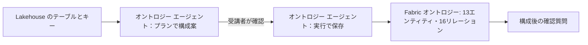

# Lab 02 — Fabric オントロジーを構成する



[目次](./README.md) · [English](../en/lab-02-ontology.en.md)

**所要時間：25分｜成果物：`studentN_mfg_ontology` と設定前の回答**

## 開始画面：自分の Fabric ワークスペースの項目一覧

[Fabric ポータル](https://app.fabric.microsoft.com/)の左ナビゲーションで **ワークスペース** を選び、講師指定の自分のワークスペースを選びます。このLabでは、[Lab 01](./lab-01-data.ja.md) で作成した `mfg_ontology_lh` の15テーブルを使います。

## 1. オントロジーを作成する

1. 項目一覧の上部で **新しい項目** を選び、項目カタログの検索欄に「オントロジー」と入力します。検索結果の **オントロジー (プレビュー)** を選びます。
2. **名前** には、Lab 00 で作成した自分のプロジェクト名 `studentN` に `_mfg_ontology` を付けた名前を入力します。たとえばプロジェクトが `student03` なら `student03_mfg_ontology` です。**場所** が自分のワークスペースであることを確認して **作成** を選びます。
3. 空のキャンバスが開いたら、画面上部のオントロジー名が入力したとおりであることを確認します。Lab 03・05 で使うため、名前とブラウザーの URL を控えます。

**受講者別の名前にする理由：** Foundry はオントロジーの表示名をもとに接続名を作ります。同じ親 Foundry リソースの下では、プロジェクトや Fabric ワークスペースが別でも、同名のオントロジーを選ぶと接続名が重複します。自分のプロジェクト名を先頭に付けて区別します。

## 2. データと関係をバインドする

**プロンプトの読み方：** オントロジーは、受注や設備など、業務で扱うものとそのつながりを表すモデルです。ここでは Lab 01 で取り込んだデータを、業務の言葉でたどれるようにします。手順2ではコードブロックだけを送信します。

- **型・テーブル・キー：** `SalesOrder = erp_sales_orders (order_id)` は、「顧客受注」というエンティティ型 `SalesOrder` を `erp_sales_orders` テーブルに結び付け、各受注を `order_id` で見分ける、という指示です。この結び付けを**バインド**、1件を見分ける項目を**キー**と呼びます。IDや数量など、型が持つデータ項目は**プロパティ**です。
- **関係と矢印：** `fulfillsSalesOrder: WorkOrder.sales_order_id -> SalesOrder.order_id` は、製造指図側の `sales_order_id` と顧客受注側の `order_id` の値で結ぶ、という指示です。たとえば製造指図 `WO-2026-1001` の `sales_order_id` は `SO-2026-001` なので、そのIDを持つ顧客受注にたどれます。この2列を直接使って関係を作ります。
- **今回作る範囲：** 下の一覧にある13テーブルから型を作り、16本の関係を定義します。**プラン** で構成案を作り、**実行** でモデルの定義を保存します。レイクハウスは参照元として使います。

1. 新しいキャンバスの中央にある **オントロジー エージェントで開始** を選び、右側にチャットを表示します。
2. チャット入力欄の下で **プラン** を選び、下のベース構成用プロンプトを入力欄に貼り付けて送信します。

   ```text
   Draft the base ontology using only mfg_ontology_lh in the current workspace.
   現在のワークスペースの mfg_ontology_lh だけを使い、構成案を作成してください。
   Use the default namespace. Bind the columns using their original names and set the indicated entity keys.
   Do not change source data. Leave namespaces, synonyms, extra metadata and business rules for Lab 03.
   Use direct column joins without a mapping table for fulfillsSalesOrder, processedByEquipment, and consumesMaterialLot.

   Entity = table (key):
   Customer = erp_customers (customer_id)
   Supplier = erp_suppliers (supplier_id)
   Material = erp_materials (material_id)
   Product = erp_products (product_id)
   SalesOrder = erp_sales_orders (order_id)
   PurchaseOrder = erp_purchase_orders (po_id)
   ProductionLine = mes_production_lines (line_id)
   Equipment = mes_equipment (equipment_id)
   MaterialLot = mes_material_lots (material_lot_id)
   WorkOrder = mes_work_orders (order_id)
   QualityInspection = mes_quality_inspections (inspection_id)
   Sensor = iot_sensors (sensor_id)
   EquipmentAlert = iot_equipment_alerts (alert_id)

   Relationship: source foreign key -> target key:
   placedByCustomer: SalesOrder.customer_id -> Customer.customer_id
   ordersProduct: SalesOrder.product_id -> Product.product_id
   fulfillsSalesOrder: WorkOrder.sales_order_id -> SalesOrder.order_id
   producesProduct: WorkOrder.product_id -> Product.product_id
   scheduledOnLine: WorkOrder.line_id -> ProductionLine.line_id
   processedByEquipment: WorkOrder.equipment_id -> Equipment.equipment_id
   consumesMaterialLot: WorkOrder.material_lot_id -> MaterialLot.material_lot_id
   locatedInLine: Equipment.line_id -> ProductionLine.line_id
   lotOfMaterial: MaterialLot.material_id -> Material.material_id
   suppliedByVendor: MaterialLot.supplier_id -> Supplier.supplier_id
   primarySupplier: Material.primary_supplier_id -> Supplier.supplier_id
   backupSupplier: Material.backup_supplier_id -> Supplier.supplier_id
   inspectedForWorkOrder: QualityInspection.work_order_id -> WorkOrder.order_id
   triggeredOnEquipment: EquipmentAlert.equipment_id -> Equipment.equipment_id
   monitoredBySensor: Sensor.equipment_id -> Equipment.equipment_id
   poToSupplier: PurchaseOrder.supplier_id -> Supplier.supplier_id
   ```

3. **適用前に構成案を確認する。** 右側のチャットの回答に表示されたプレビューを選びます。キャンバスで、`mfg_ontology_lh` にバインドする13エンティティと16リレーションを確認します。特に、手順5の表にある3本の名前があり、いずれも `WorkOrder` を起点として表の相手につながっていることを確認します。相違や抜けがあれば **プラン** のチャットで修正を依頼し、新しいプレビューを確認します。結合列は、適用後に手順5で照合します。
4. 確認した構成案を適用します。同じチャットの入力欄の下で **プラン** の隣の書き込みを許可するモードに切り替え、「レビューした構成案を適用してください」と送ります。左の **エクスプローラー** に定義が反映されたら **プラン** に戻します。
5. **保存済みの結合列を照合する。** Fabric に保存されたリレーションシップの設定を、下の表の列名と照合します。

   1. オントロジーの上部リボンで **ホーム** を選びます。中央のキャンバスで、`WorkOrder` と `SalesOrder` を結ぶ `fulfillsSalesOrder` の線を選びます。
   2. 開いた[リレーションシップの構成画面](https://learn.microsoft.com/ja-jp/fabric/iq/ontology/how-to-create-relationship-types#edit-or-delete-relationship-type)で、**マッピングテーブルを使用する** がオフであり、起点側の **プロパティ 1** が `sales_order_id`、対象側の **プロパティ 1** が `order_id` であることを確認します。
   3. **キャンセル** で閉じます。残りの2本も、1本ずつ **ホーム** に戻って該当する線を選び、起点・対象それぞれの **プロパティ 1** を下の表と照合します。確認するたびに **キャンセル** で閉じます。

   | リレーションシップ名 | 起点のエンティティと結合列 | 対象のエンティティと結合列 |
   | --- | --- | --- |
   | `fulfillsSalesOrder` | `WorkOrder.sales_order_id` | `SalesOrder.order_id` |
   | `processedByEquipment` | `WorkOrder.equipment_id` | `Equipment.equipment_id` |
   | `consumesMaterialLot` | `WorkOrder.material_lot_id` | `MaterialLot.material_lot_id` |

   `WorkOrder.order_id` は製造指図自身のIDです。受注への結合には `WorkOrder.sales_order_id` を使います。

   設定が表と異なる場合は、**ホーム → オントロジー エージェント** でチャットを開き、**プラン** でリレーションシップ名と正しい列を指定して修正を依頼します。新しいプレビューを確認し、手順4で適用してからこの手順でもう一度照合します。

## 3. 設定前の回答を控える

ここでいう「設定前」は、テーブルと関係を構成し、Lab 03 で同義語・状態コードの説明・判断ルールを加える前の状態です。「ワーク」と「営業のオーダー」をそれぞれどの型に結び付け、どのデータを根拠に答えるかを記録します。

右側のチャットが閉じていたら、上部リボンの **ホーム → オントロジー エージェント** を選びます。**プラン** のまま、次の質問を入力して送信します。回答と使われたエンティティ名を控え、Lab 03 で設定を加えた後の根拠と見比べます。

```text
浜松第2ラインで品質保留中のワークと、それにひもづく営業のオーダーを区別してください。ERPに未反映の納期リスクがあれば、根拠のIDも示してください。
```

**チェックポイント：** **エクスプローラー** の `SalesOrder` と `WorkOrder` がテーブルにバインドされ、保存された3本の結合列が表と一致することを確認します。設定前の回答を控え、Lab 03 で設定後の回答と根拠を比べます。

[公式画面：オントロジーの作成](https://learn.microsoft.com/ja-jp/fabric/iq/ontology/tutorial-1-create-ontology) · [オントロジー エージェント](https://learn.microsoft.com/ja-jp/fabric/iq/ontology/how-to-use-ontology-agent) · [次：Lab 03](./lab-03-impact.ja.md)
