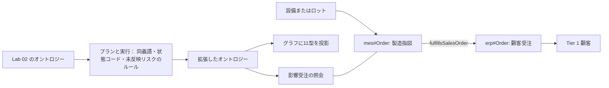

# Lab 03 — 意味を追加し、影響をたどる



[目次](./README.md) · [English](../en/lab-03-impact.en.md)

**所要時間：30分｜成果物：業務ルールを含むオントロジー、根拠付きの影響受注一覧**

## 開始画面：Lab 02 で保存したオントロジー

[Fabric ポータル](https://app.fabric.microsoft.com/)の左ナビゲーションで **ワークスペース** を選び、講師指定の名前を選びます。項目一覧で [Lab 02](./lab-02-ontology.ja.md) で控えた自分の `studentN_mfg_ontology` の名前を選びます。このLabでは、そのオントロジーに業務上の意味を加えます。

## 1. ERPとMESの「オーダー」を区別する

**プロンプトの読み方：** Lab 02 で決めたデータのつながりを引き継ぎ、エージェントに「項目や数値をどう読み、どの条件で納期リスクと判断するか」を伝えます。

1. **名前空間と同義語：** `erp#Order` は販売管理の ERP にある顧客受注、`mes#Order` は製造実行の MES にある製造指図です。`#` の前が型を区別する**名前空間**、後が型名です。同じ `Order` でも `erp` と `mes` で区別でき、「営業オーダー」や「ワーク」などの**同義語**は、それぞれ同じ型を指す別の呼び方になります。Lab 02 で作成した2つの型を更新します。
2. **状態コードの説明：** たとえば `3` は、受注の `order_status_code` では納期リスクあり（`AtRisk`）、検査の `disposition_code` では廃棄・隔離保留（`ScrapHold`）です。元のコードに対応する意味を、各プロパティの説明に記録します。
3. **業務ルール：** 対象の Tier 1（重要顧客）の受注で、ERP が生産中（`2`）、製造または検査で保留、関連する全製造指図の良品合計が受注数量未満、の3条件がそろった場合に「ERP未反映の納期リスク」と判断します。たとえば10個の受注に対して2件の製造指図の良品が6個と2個なら、不足は2個です。ERP の状態と保留も確認し、3条件を照会・判定の根拠に使います。

画面上部のリボンで **ホーム → オントロジー エージェント** を選びます。右側のチャット入力欄の下で **プラン** を選び、次のコードブロックだけを貼り付けて送信します。

```text
13エンティティと16リレーション、既存のキーとテーブルバインドを維持して、次の変更案を作ってください。元データは更新しないでください。
1. 既存の SalesOrder の型名を Order に変更し、名前空間 erp に割り当てて erp#Order とする。「営業オーダー」「顧客受注」「sales order」を同義語にする。既存の WorkOrder も型名を Order に変更し、名前空間 mes に割り当てて mes#Order とする。「ワーク」「製造指図」「work order」を同義語にする。fulfillsSalesOrder は mes#Order.sales_order_id → erp#Order.order_id のまま維持する。他のエンティティの名前空間は変更しない。
2. プロパティの説明に、erp#Order.order_status_code は 2=InProduction、3=AtRisk、mes#Order.wo_status_code は 30=QualityHold、QualityInspection.disposition_code は 3=ScrapHold と追記する。
3. HiddenErpOrderRiskEscalation を追加し、erp#Order と mes#Order に関連付ける。対象の Tier 1 受注では、ERPが2でも、MESが品質保留または検査がScrapHoldで、受注にひもづく良品の合計が受注数量に満たなければ、ERP未反映の納期リスクに含める。
```

### 変更案を確認して適用する

1. **適用前：** 右側のチャットの回答に表示されたプレビューを選びます。中央の読み取り専用のキャンバスで、ERPとMESの `Order` が別々で、`fulfillsSalesOrder` でつながっていることを確認します。今回の更新対象以外のエンティティ型とリレーションシップは、Lab 02 の構成が維持されていることを確認します。差分があれば **プラン** のチャットで修正を依頼し、新しいプレビューを開きます。
2. **適用：** 確認後、チャット入力欄の下で **プラン** の隣にある書き込みを許可するモードに切り替え、「レビューした変更案を適用してください」と送ります。左の **エクスプローラー** に変更が反映されたら **プラン** に戻します。テーブル名、同義語、説明、ルール本文は、次の手順で保存された設定を読みます。

### 保存された設定を確認する

変更案を適用したら、**エクスプローラー** で既存の2つの型の名前空間を確認します。既定の名前空間に `SalesOrder` や `WorkOrder` が表示される場合は、チャットで適用結果を確認し、上の手順で既存の型を更新します。

1. **名前空間・参照テーブル・同義語：** **ホーム** の左側の **エクスプローラー** で、検索欄の右隣の **…** を選び、グループ化の項目の **名前空間** を選びます。`erp` と `mes` のグループを展開し、各グループの型を1つずつ確認します。型を選び、上部リボンの **エンティティ タイプ → 詳細を開く** を選びます。**構成** で型名と、**詳細** の **名前空間** を確認します。**プロパティ** の `order_id` 行の **データ ソース** を下の表と見比べます。画面下部のエンティティのメタデータ欄で **編集** を選び、同義語を読み、**キャンセル** で閉じます。上部の **ホーム** に戻り、もう一方のグループの型でも同じ操作を行います。

   | 名前空間と型名 | `order_id` のデータ ソース | 同義語 |
   | --- | --- | --- |
   | `erp` の `Order`（`erp#Order`） | `erp_sales_orders.order_id` | 営業オーダー、顧客受注、`sales order` |
   | `mes` の `Order`（`mes#Order`） | `mes_work_orders.order_id` | ワーク、製造指図、`work order` |

2. **状態コードの説明：** **ホーム** に戻り、対象のエンティティ型を選びます。キャンバスのエンティティ名の横の **…** から **データをバインド** を選びます。左ペインのソース一覧の下にあるエンティティのプロパティ一覧を選び、表に示すプロパティの行で **メタデータ** を選びます。開いた画面の **説明** を表と照合し、**キャンセル** で閉じます。3つのプロパティをそれぞれ同じ方法で確認します。

   | エンティティ型 | 開くプロパティ | 説明にある状態コード |
   | --- | --- | --- |
   | `erp#Order` | `order_status_code` | `2=InProduction`、`3=AtRisk` |
   | `mes#Order` | `wo_status_code` | `30=QualityHold` |
   | `QualityInspection` | `disposition_code` | `3=ScrapHold` |

3. **リレーションシップ：** **ホーム** に戻り、キャンバス上の `fulfillsSalesOrder` の線を選びます。起点の型が `mes#Order`、**プロパティ 1** が `sales_order_id`、対象の型が `erp#Order`、**プロパティ 1** が `order_id` であることを確認し、**キャンセル** で閉じます。
4. **業務ルール：** **ホーム** の **エクスプローラー → ルール** を展開し、`HiddenErpOrderRiskEscalation` を選びます。**リンクされたオントロジー要素** に両方の `Order` があることを確認します。**定義** では、対象の Tier 1 受注について、ERPが `2`、かつ「MESが `30` または検査が `3`」、かつ「関連する製造指図の `good_qty` 合計が受注の `order_qty` 未満」のときに、**ERP未反映の納期リスク**に含めると読めれば一致です。

設定が異なる場合は、**ホーム → オントロジー エージェント** で **プラン** のチャットを表示し、型・プロパティ・リレーションシップ・ルールのうち該当する名前と正しい設定値を指定して修正を依頼します。新しいプレビューを確認して適用し、該当箇所を開き直してから次へ進みます。

## 2. オントロジーから影響範囲を取得する

この質問では、設備や材料ロットを手がかりに製造指図を探し、そこから顧客受注、顧客へと、Lab 02 で定義した関係をたどります。Lab 03 の状態コードとルールで「ERP反映済み」と「ERP未反映」のリスクを分けます。設備とロットの両方から同じ受注にたどり着いても、受注の件数と金額には1回だけ数えます。

**ホーム** に戻ります。右側のチャットが閉じていれば、上部リボンの **オントロジー エージェント** を選んで表示します。**プラン** のまま次を入力欄に貼り付けて送信します。使用されたクエリ言語（SQL、KQL、GQL）を記録し、オントロジーの関係と状態の説明が回答の根拠になっていることを確認します。

```text
2026-05-14 のスナップショットで、EQ-VBF-204 または LOT-MAG-088 から、ワーク、営業オーダー、Tier 1 顧客をたどってください。対象はMESの品質保留または検査のScrapHoldがあり、ERPでリスク反映済みか、良品不足でERPに未反映の受注です。根拠のワークID、ERPとMESの状態コード、未反映の有無を挙げてください。営業受注IDで重複を除き、受注額の合計と顧客別の日次遅延違約金およびその合計を示してください。
```

**チェックポイント：** `SO-2026-004`、`SO-2026-009`、`SO-2026-015` の **3受注、9,970万円、235万円/日**。`SO-2026-015` は ERP `2=InProduction`、`WO-2026-1019` は MES `30=QualityHold` で良品不足のため、ERP未反映です。Lab 01 の2受注から何が増えたかを説明し、Lab 02 の回答と比べて設定後の根拠が明確か確認します。

## 3. グラフで関係を確認する

1. 同じオントロジー キャンバスの上部リボンで **ホーム → 管理 → グラフ** を選びます。**検証を確認** で結果を読み、**エンティティの選択** を選びます。
2. 投影するエンティティの一覧で `PurchaseOrder` と `Sensor` のチェックを外し、残り11型とその間の関係を選択したままにします。右のプレビューで「設備またはロット → ワーク → 受注 → 顧客」のつながりを確認し、画面下部の **続行** を選びます。投影の概要で選択内容を確認して **マテリアライズ** を選びます。
3. 同じ画面でデータの読み込みまたは更新が完了したことを確認し、手順2のオントロジー照会とは別に記録します。待ち時間が長い場合は「グラフ読み込み待ち」と記録し、Lab 04 へ進みます。

## 発展（＋15分）：グラフ探索とSQLでの照合

データロード後、左ナビゲーションの **ワークスペース** から自分の項目一覧へ戻ります。手順3で作成した `studentN_mfg_ontology_graph_` で始まる名前のグラフモデルを選び、上部の **クエリ → 今すぐクエリ** で経路を探索します。

### ノートブックで受注IDと合計を照合する

[Fabric ポータル](https://app.fabric.microsoft.com/)の **ワークスペース** で自分のワークスペースを選び、項目一覧で Lab 01 のノートブック名を選びます。`mfg_ontology_lh` が既定であることを確認します。最後のセルの下にポインターを置いて **コード** を選び、下のSQLを `%%sql` の行から貼り付け、セル左側の **実行** を選びます。

```sql
%%sql
WITH incident_orders AS (
    SELECT DISTINCT w.sales_order_id
    FROM mes_work_orders w
    WHERE (w.equipment_id = 'EQ-VBF-204' OR w.material_lot_id = 'LOT-MAG-088')
      AND (w.wo_status_code = 30 OR EXISTS (
          SELECT 1
          FROM mes_quality_inspections q
          WHERE q.work_order_id = w.order_id AND q.disposition_code = 3
      ))
),
good_quantity AS (
    SELECT sales_order_id, SUM(good_qty) AS available_qty
    FROM mes_work_orders
    GROUP BY sales_order_id
)
SELECT s.order_id, s.order_status_code, s.order_amount_jpy,
       c.customer_id, c.sla_penalty_jpy_per_day,
       COUNT(*) OVER () AS affected_orders,
       SUM(s.order_amount_jpy) OVER () AS total_exposure_jpy
FROM incident_orders i
JOIN erp_sales_orders s ON i.sales_order_id = s.order_id
JOIN erp_customers c ON s.customer_id = c.customer_id
JOIN good_quantity g ON g.sales_order_id = s.order_id
WHERE c.customer_tier = 'Tier1'
  AND (s.order_status_code = 3
       OR (s.order_status_code = 2 AND g.available_qty < s.order_qty))
ORDER BY s.order_id;
```

**期待値：** `SO-2026-004`、`SO-2026-009`、`SO-2026-015` の **3件・99,700,000円**。いずれか1行の `total_exposure_jpy` を全体合計として読み取ります。

Lakehouse SQL の結果は照合に使います。オントロジー照会は手順2、Foundry の統合テストは Lab 06 の応答とトレースで確認します。

[公式画面：エンティティの詳細](https://learn.microsoft.com/ja-jp/fabric/iq/ontology/how-to-view-ontology-details) · [業務ルールとメタデータ](https://learn.microsoft.com/ja-jp/fabric/iq/ontology/tutorial-2-enrich-ontology) · [グラフの構成](https://learn.microsoft.com/ja-jp/fabric/iq/ontology/how-to-use-ontology-graph) · [次：Lab 04（休憩後）](./lab-04-knowledge.ja.md)
