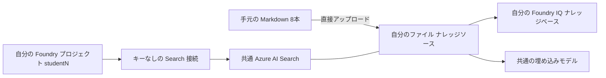

# Lab 04 — 文書をアップロードし、Foundry IQ を構成する

[目次](./README.md) · [English](../en/lab-04-knowledge.en.md)

**所要時間：25分｜成果物：共通 Search への接続、`ks-studentN-mfg-ops`、`kb-studentN-mfg-ops`**

## 開始画面：自分の Foundry プロジェクト

1. [Lab 00](./lab-00-setup.ja.md) で使用した **Azure ポータル** の親リソースのリンクを開き、**リソース管理 → プロジェクト** で自分が作成した `studentN` を選びます。
2. `studentN` の **概要** で、Foundry ポータルに移動するリンクを選びます。移動先で **新しい Foundry** をオンにし、画面左上が `studentN` であることを確認します。この Foundry プロジェクトのURLを Lab 05・06 用に控えます。

## 1. 自分のプロジェクトを共通 Search に接続する

1. `studentN` の上部で **管理**、左側で **プロジェクトの詳細** を選びます。**ユーザー** の隣の接続一覧のタブを開き、**接続の追加 → Azure AI Search → 続行** の順に選びます。
2. **新しい接続の作成** では、最初に表示されるリソース選択画面のまま、**Azure AI Search** 欄の一覧から講師指定のサービス名を選びます。**認証の種類** で **プロジェクトのマネージド ID** を選び、**接続** を選びます。
3. 接続一覧に追加された名前を Lab 05 用に控えます。上部の **ビルド**、左側の **ナレッジ** の順に選び、ナレッジ ベース一覧の上の **接続** で今作成した接続を選びます。共通 Search 上では、自分の受講者番号のナレッジ ベースだけを使用します。

## 2. ファイル ナレッジソースを作成する

1. 一覧上の **ナレッジ ベースの作成** を選び、**基本構成 → 名前** に `kb-studentN-mfg-ops` を入力します。**取得品質の向上** は既定の最小の取得設定のまま進みます。
2. **ナレッジ ソース (Foundry IQ)** で **ファイルのアップロード** を選びます。ダウンロードした `jp` フォルダー内の [`./data/unstructured_docs/`](./data/unstructured_docs/) から、下表の `.md` 8本だけを配布時の名前と内容のまま選びます。文書IDは、後のLabで引用を確認するときに使います。

   | ファイル名 | 文書ID | 主な内容 |
   | --- | --- | --- |
   | [`GLOSSARY_enterprise_domain_terms.md`](./data/unstructured_docs/GLOSSARY_enterprise_domain_terms.md) | `DOC-GLOSSARY` | 「オーダー」などの用語の部門ごとの意味、同義語、状態コードや計測単位を整理したヒアリングメモ。 |
   | [`INC-2026-1028_hamamatsu_line2_brazing_incident.md`](./data/unstructured_docs/INC-2026-1028_hamamatsu_line2_brazing_incident.md) | `DOC-INC-1028` | 浜松第2ラインで過去に起きた真空シール劣化と接合ボイドの8D調査報告。過去の原因調査と対策の参考資料です。 |
   | [`MAN-MAT-NDFEB_magnet_lot_handling.md`](./data/unstructured_docs/MAN-MAT-NDFEB_magnet_lot_handling.md) | `DOC-MAN-NDFEB` | ネオジム磁石の受入・投入前の水分基準と、再処理・返品・認定済みの代替仕入先への切り替え条件。 |
   | [`POL-SCM-002_emergency_expedite_and_airfreight.md`](./data/unstructured_docs/POL-SCM-002_emergency_expedite_and_airfreight.md) | `DOC-POL-SCM002` | 納期リスクをエスカレーションする条件、工場間振替・代替調達・緊急輸送の優先順位、緊急手配の決裁権限。 |
   | [`QMS-STD-004_actuator_quality_disposition.md`](./data/unstructured_docs/QMS-STD-004_actuator_quality_disposition.md) | `DOC-QMS-004` | トルクリップル、接合ボイド、絶縁抵抗などの合否と、不適合時の再加工・隔離・出荷停止の判定基準。 |
   | [`SLA-CUS-001_tier1_robotics_contract_summary.md`](./data/unstructured_docs/SLA-CUS-001_tier1_robotics_contract_summary.md) | `DOC-SLA-TIER1` | Tier 1顧客ごとの納期遅延違約金、初動8D報告の起算イベントと期限、設備振替や代替材料に関する個別条件。 |
   | [`SOP-EQ-CNC-101_spindle_vibration_maintenance.md`](./data/unstructured_docs/SOP-EQ-CNC-101_spindle_vibration_maintenance.md) | `DOC-SOP-CNC101` | 研削盤CNC-101の校正周期、校正期限を過ぎた場合の作業割当制限、スピンドルの振動異常への対応。 |
   | [`SOP-EQ-VBF-204_vacuum_brazing_furnace.md`](./data/unstructured_docs/SOP-EQ-VBF-204_vacuum_brazing_furnace.md) | `DOC-SOP-VBF204` | 真空ろう付け炉VBF-204・VBF-205の運転管理限界、温度や真空圧の異常時の初動、再稼働・代替炉への振り替え条件。 |

3. ファイルを選ぶと表示されるソース作成画面で `ks-studentN-mfg-ops` を入力し、指定の **埋め込みモデル** を確認します。**コンテンツ抽出モード** は既定の **最小** のまま、**作成** を選びます。
4. `ks-studentN-mfg-ops` の行に8本が表示されたら、画面上部の **ナレッジ ベースの保存** を選びます。`429` の場合は案内された時間を待ち、失敗したファイルの **再試行** だけを選びます。

**チェックポイント：** 保存したナレッジ ベースにこのLabの **ファイル** 型ソースが含まれ、そのファイル一覧で8本が **準備完了** になったことを確認してから Lab 05 に進みます。`403` が出る、またはアップロード操作が表示されない場合は、自分のプロジェクトと手順1で作成した Search 接続を選んでいることを確認します。

[公式資料：ファイルの直接アップロード](https://learn.microsoft.com/ja-jp/azure/search/agentic-knowledge-source-how-to-file) · [接続画面](https://learn.microsoft.com/ja-jp/azure/foundry/how-to/connections-add) · [次：Lab 05](./lab-05-agent.ja.md)
