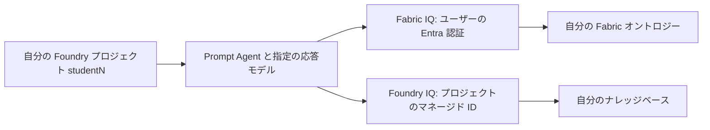

# Lab 05 — Foundry エージェントを接続する



[目次](./README.md) · [English](../en/lab-05-agent.en.md)

**所要時間：30分｜成果物：`mfg-shipment-advisor-studentN` と2つの呼び出しのトレース**

## 開始画面：自分の Foundry プロジェクトのツール一覧

[Lab 04](./lab-04-knowledge.ja.md) で控えた Foundry プロジェクトのURLを開き、左上が `studentN` であることを確認します。上部の **ビルド**、左ナビゲーションの **ツール**、中央上部の **ツール** タブの順に選びます。このLabでは、Lab 03 で更新した `studentN_mfg_ontology` と、Lab 04 で保存して8文書が準備完了になった `kb-studentN-mfg-ops` を接続します。

## 1. オントロジーへの接続を追加する

1. ツール一覧の上の **ツールを接続** を選びます。ツール選択画面で **Fabric IQ (OneLake カタログ)** のカードを選び、下部の **ツールの追加** を選びます。
2. 開いた OneLake カタログの **フィルター** で **オントロジー** を選び、初期選択の **セマンティック モデル** を外します。検索欄に Lab 02 で控えた名前（例：`student03_mfg_ontology`）を入力します。候補行のオントロジー名とワークスペース名が両方とも自分のものと一致した行だけを選び、下部の **追加** を選びます。目的のアイテムが候補に出ない場合は、検索名とフィルターを確認します。
3. 追加した接続をツール一覧で選びます。詳細の **リモート MCP サーバー エンドポイント** で `/items/` の直後にあるアイテム ID が、Lab 02 で控えた URL の `/ontologies/` の直後にある ID と一致することを確認します。**認証** が **OAuth ID パススルー**（受講者本人の Microsoft Entra 認証）であることを確認し、次の手順で使うため、ツール一覧に表示される接続名を控えます。

## 2. エージェントに接続を追加する

1. **ビルド** の左ナビゲーションで **エージェント**、一覧上部の **新しいエージェント → エージェントの構築** を選びます。**エージェント名** に `mfg-shipment-advisor-studentN` を入力し、**対話モデル** は **テキスト** のまま、Copilot ハーネスはオフにします。**エージェントを作成してプレイグラウンドを開く** を選びます。
2. 作成したエージェントの **プレイグラウンド** で、左側の **モデル** から講師指定のデプロイを選びます。**ツール** の **追加** メニューでは **Web 検索** をオフにし、**ツールの追加** を選びます。**構成済み** タブで手順1の接続名を選び、下部の **ツールを追加** を選びます。
3. 左側の **ナレッジ → 追加 → Foundry IQ に接続する** を選びます。**接続** で Lab 04 で控えた Search 接続、**ナレッジ ベース** で `kb-studentN-mfg-ops` を選び、下部の **接続** を選びます。左の **ツール** と **ナレッジ** にそれぞれの接続が表示されることを確認します。
4. 左の **手順** を展開し、入力欄に次を貼り付けます。上部の **保存** を選び、保存されたバージョンが表示されたことを確認します。

```text
浜松第2ラインの出荷判断を支援する。2026-05-14 の研修スナップショットだけを使い、日本語で回答する。データだけなら Fabric IQ、文書だけなら Foundry IQ、出荷判断や個別案件の正確な初動8D期限には両方を呼ぶ。

Fabric IQ：対象の設備またはロットからワーク、受注、Tier 1 顧客を追う。対象は (1) MESが30（QualityHold）または検査が3（ScrapHold）であり、かつ (2) ERPが3（AtRisk）、またはERPが2（InProduction）のままで受注にひもづく良品数の合計が受注数量未満、の両方を満たす受注。ERPの「リスク反映済み」は3だけとし、条件を満たす2は必ず「ERP未反映のリスク」と表示する。受注IDで重複排除して金額を合計し、潜在的な日次遅延違約金は顧客ごとに一度だけ計上する。受注・ワーク・顧客IDとERP/MESの別々の状態を示す。

影響調査では Fabric IQ の照会を分ける。2026-05-14 はスナップショットの基準日とし、行の日付では絞り込まない。まず、設備またはロットが一致する mes#Order を equipment_id または material_lot_id で検索し、order_id、sales_order_id、wo_status_code、good_qty を取得する。最初の照会では ERP 状態と顧客区分で絞らない。次に、取得した受注IDで erp#Order の order_status_code、order_qty、order_amount_jpy と、Customer の customer_id、customer_tier、sla_penalty_jpy_per_day を取得する。列名は記載どおり使い、Tier 1 のコード値は Tier1 とする。結合結果に必要な列がなければ、そのエンティティをIDで個別に照会する。必要に応じて disposition_code と関連する全ワークオーダーの good_qty 合計を確認し、取得結果にリスク条件を適用して集計する。

Foundry IQ：設備・品目・顧客IDで規程・SOP・SLAを検索し、判断に使った条件を文書IDまたはファイル名と引用で示す。Fabric IQ の受注合計を決裁規程に当てはめる。受注額（円）と日次違約金（円/日）は別々に示し、合算しない。受注額を損失額と扱わない。各顧客にはSLAの起算イベントと時間数を適用する。

初動8D：CUS-003 の起算イベントは、対象ワークのMES QualityHoldの記録。正確な締切は、対応するMES記録の時刻を取得できた場合だけ計算する。検査時刻、設備アラート時刻、予定日時、スナップショットの日付は代用禁止。時刻の根拠がなければ「正確な締切日時は算定不可」と述べ、SLAの期限条件と確認すべき記録を示す。

事実、文書根拠、対応案、未確認事項を分ける。取得失敗を「影響なし」とせず、不足した根拠を明記する。書き込み、決裁、発注、出荷解除、顧客への通知は実行しない。
```

## 3. 個別に確認する

保存したエージェントの **プレイグラウンド** で、右側の **チャット** を選びます。質問ごとに上部の **新しいチャット** を選び、**エージェントにメッセージを送信...** に「入力メッセージ」のコードブロックだけを貼り付けます。入力欄の右端の **送信** を選びます。回答が完了したら、その下の **トレース** を選び、**応答** を展開してツール呼び出しを確認します。質問2はトレース パネルを閉じ、もう一度 **新しいチャット** を選んでから送ります。

### 質問1：Fabric IQ で影響受注を確認する

**入力メッセージ：**

```text
Fabric IQ だけを使い、2026-05-14 の研修スナップショットで、EQ-VBF-204 または LOT-MAG-088 に関連して影響を受けた Tier 1 の受注を、ERP未反映分も含めて一覧にしてください。
受注IDごとに1件とし、ERPの状態コードと、リスクがERPに反映済みか未反映かを示してください。未反映分は、根拠となる製造指図ID、MESの状態コード、良品数と受注数量も示してください。
```

**期待する出力の要旨：**

- `SO-2026-004` と `SO-2026-009` は ERP `3 (AtRisk)` でリスク反映済み。
- `SO-2026-015` は ERP `2 (InProduction)` のままなのでリスク未反映。製造指図 `WO-2026-1019` は MES `30 (QualityHold)` で、良品15に対して受注数量は40。
- トレースで `ask_ontology` の成功と、取得結果を回答の根拠に使ったことを確認する。

### 質問2：Foundry IQ で決裁規程と SLA を確認する

**入力メッセージ：**

```text
Foundry IQ だけを使い、DOC-POL-SCM002 の緊急手配で COO 決裁が必要になる対象受注の合計額と緊急追加費用の条件を教えてください。
また、CUS-003 の初動8Dは何を起点とし、何時間以内に提出する必要がありますか。規程と SLA の両方について、文書IDと該当箇所の引用を示してください。今回の受注額や具体的な締切日時は計算しないでください。
```

**期待する出力の要旨：**

- `DOC-POL-SCM002`：対象受注合計が **9,000万円以上、または** 緊急追加費用が **300万円以上**なら COO 決裁。
- `DOC-SLA-TIER1`：`CUS-003` の初動8Dは、MES に `QualityHold`（コード `30`）が記録された時点から **24時間以内**。
- トレースで `knowledge_base_retrieve` の成功と、回答が両方の文書の該当箇所を引用していることを確認する。

**チェックポイント：** 質問1は `ask_ontology`、質問2は `knowledge_base_retrieve` の出力を開き、回答と一致することを確認して Lab 06 に進みます。取得に成功しても判定が違う場合は回答を根拠と照合し、指示を確認・保存して新規チャットで再試行します。ツール承認を求められた場合は接続先と読み取り操作を確認してから許可します。

**発展（＋15分）：** 同じ文書質問を、現場用語だけの場合と設備・顧客IDを添えた場合とで比較し、引用元が判断に使えるか確認します。

[公式画面：Fabric IQ ツール](https://learn.microsoft.com/ja-jp/azure/foundry/agents/how-to/tools/fabric-iq) · [Foundry IQ の接続](https://learn.microsoft.com/ja-jp/azure/foundry/agents/how-to/foundry-iq-connect) · [次：Lab 06](./lab-06-review.ja.md)
