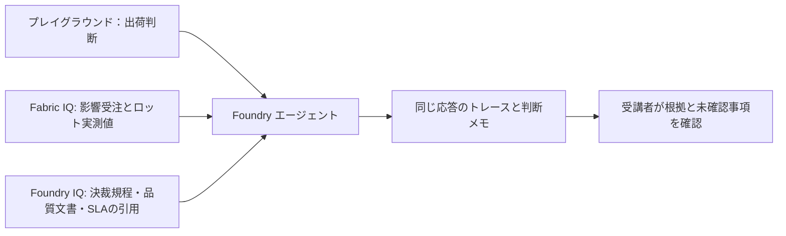

# Lab 06 — 出荷判断をレビューする



[目次](./README.md) · [English](../en/lab-06-review.en.md)

**所要時間：30分｜成果物：出荷判断メモ1枚と両ツールのトレース**

## 開始画面：自分のエージェントのプレイグラウンド

[Lab 04](./lab-04-knowledge.ja.md) で控えた Foundry プロジェクトのURLを開き、左上が `studentN` であることを確認します。上部の **ビルド**、左側の **エージェント** の順に選び、[Lab 05](./lab-05-agent.ja.md) で作成した `mfg-shipment-advisor-studentN` を開きます。上部の **プレイグラウンド** と右側の **チャット** を選びます。**バージョン** で、Lab 05 で両方の接続を保存した版を確認します。

## 1. 判断メモを作成し、根拠を照合する

右側のチャット欄上部で **新しいチャット** を選び、下部の **エージェントにメッセージを送信...** にコードブロックだけを貼り付けて、入力欄右端の **送信** を選びます。

**入力メッセージ：**

```text
浜松第2ラインの EQ-VBF-204 または LOT-MAG-088 の影響について出荷判断メモを作ってください。
Fabric IQで、ERP未反映分を含むTier 1の影響受注、重複を除いた受注額、日次遅延違約金、およびLOT-MAG-088の実測水分（moisture_ppm）を確認してください。一度に取れなければ、ロットの値を別に照会してください。
Foundry IQで、緊急手配の決裁規程、隔離・代替設備／部材の条件、顧客別の初動8Dの起算イベントと時間数を調べ、出典を引用してください。
決裁の受注額基準には、重複を除いた受注額だけを当てはめてください。ロットの実測水分と規程のしきい値を比べ、事実、文書根拠、対応案、未確認事項を分けてください。
メモは「影響受注と金額」「緊急手配の決裁」「品質対応と代替案」「初動8Dと未確認事項」の順にまとめてください。
```

**同じ応答のトレースを開く：** 回答のすぐ下にある **トレース** を選びます。この質問の **応答** を展開し、Fabric IQ の `ask_ontology` と Foundry IQ の `knowledge_base_retrieve` が両方とも成功していることを確認します。各呼び出しを選び、返された値や文書を下表に沿ってメモ本文と照合します。同じツールが複数回呼ばれた場合は、関連する出力を合わせて確認します。引用元は文書IDまたはファイル名で照合します。

**期待する出力と照合先：**

| メモの箇所 | 回答で確認する内容 | トレースで確認する根拠 |
| --- | --- | --- |
| 影響受注と金額 | `SO-2026-004` と `SO-2026-009` は ERP `3 (AtRisk)` で反映済み。`SO-2026-015` は ERP `2 (InProduction)` のまま、`WO-2026-1019` が MES `30 (QualityHold)` で良品15／受注40のため **ERP未反映**。この3受注の合計 **9,970万円** と潜在違約金 **235万円/日** は別々に示される。 | `ask_ontology` の受注ID・状態・数量・受注額と、顧客ごとの日次違約金を確認する。受注額は受注IDごと、日次違約金は顧客ごとに1回ずつ数え、別々の合計を照合する。 |
| 緊急手配の決裁 | 受注合計 **9,970万円** が **9,000万円以上** の基準を満たすため、**COO決裁が必要**と説明する。緊急手配は決裁が必要な提案として示す。 | `ask_ontology` の受注額と、`knowledge_base_retrieve` が返した `DOC-POL-SCM002` の COO 決裁条件の引用。 |
| 品質対応 | 対象の製造指図の隔離を提案する。`LOT-MAG-088` は実測 **182 ppm** が **175 ppm超** の条件に該当するため、全数返品を提案する。 | `ask_ontology` の `LOT-MAG-088` の実測値（`moisture_ppm`）と、`knowledge_base_retrieve` が返した `DOC-MAN-NDFEB` の返品基準。隔離は品質基準または設備手順の引用で裏付ける。 |
| 代替案 | 認定済みの `SUP-007`／`LOT-MAG-091` を候補にする。復旧見込みが **12時間以上** の Tier 1 案件なら、`EQ-VBF-205` の校正が有効で、真空度が **2.0 Pa 以下**、空き枠があることを確認してから振替を要請する。空輸・発注・出荷は今後の判断事項として示す。 | `knowledge_base_retrieve` が返した `DOC-MAN-NDFEB` の認定代替先と `DOC-SOP-VBF204` の設備振替条件。 |
| 初動8Dと未確認事項 | `CUS-001`／`CUS-002` は検知後 **48時間以内**、`CUS-003` は **MES の品質保留記録から24時間以内**。起算時刻や設備の空き枠は、確認済みの事実と確認が必要な項目に分ける。 | `knowledge_base_retrieve` が返した `DOC-SLA-TIER1` の該当顧客の条項。期限までの時間数と起算イベントの両方を照合する。 |

### Fabric IQ と Foundry IQ を組み合わせ

緊急手配の決裁を例にすると、**Fabric IQ は「今回、何が起きたか」を示すデータを、Foundry IQ は「何を基準に判断するか」を示す規程を返します。** Foundry エージェントは両方を呼び出し、取得した事実に規程を当てはめて、一つの回答にまとめます。

- **Fabric IQ：影響を受けた受注を見つける。** `ask_ontology` は、オントロジーの関係を使って、対象設備 `EQ-VBF-204` や材料ロット `LOT-MAG-088` から、製造指図、受注、顧客をたどります。ERP では生産中の `SO-2026-015` も、製造指図 `WO-2026-1019` が品質保留中で、受注40個に対して良品が15個と分かり、影響受注に含まれます。
- **Foundry IQ：決裁の基準を見つける。** `knowledge_base_retrieve` は、ナレッジベースから緊急手配規程 `DOC-POL-SCM002` を検索し、「対象受注の合計が9,000万円以上なら COO 決裁」という条件を返します。
- **Foundry エージェント：今回の受注額に規程を当てはめる。** [Lab 01](./lab-01-data.ja.md) の ERP 初期リストは2受注・8,050万円で、追加費用が300万円未満なら SCM本部長の区分です。`SO-2026-015` の1,920万円を含めると3受注・9,970万円になり、受注額だけで9,000万円の基準を満たします。メモはこの比較を根拠に、**COO 決裁が必要**と説明します。

部材の判断も同じです。エージェントは、Fabric IQ が取得した **182 ppm（実測値）** と、Foundry IQ が取得した `DOC-MAN-NDFEB` の **175 ppm 超（返品条件）** を照合し、このロットの返品を提案します。二つの取得結果を組み合わせることで、**今回の案件で取るべき対応と、その理由**を示せます。

**自分の言葉で説明する：** 同じ応答のトレースを見て、追加で見つかった受注、引用した決裁基準、その基準を今回の受注額に当てはめた結果を説明します。

## 2. 新しいチャットで初動8Dの締切日時を確認する

締切日時を算定できるかと、算定に必要な記録を確認します。トレース パネルを閉じてチャットに戻り、**新しいチャット** を選びます。**エージェントにメッセージを送信...** に次のコードブロックだけを貼り付け、**送信** を選びます。

**入力メッセージ：**

```text
CUS-003 の今回の案件（WO-2026-1019）について、初動8Dの正確な締切日時を教えてください。
```

**期待する出力の要旨：**

- `DOC-SLA-TIER1` を引用し、MES に `QualityHold`（コード30）が記録された時点から **24時間以内**と示す。
- `WO-2026-1019` は品質保留。研修データから確認できるのは保留の状態までなので、**正確な締切日時は算定不可**と答える。算定に必要な記録として、その製造指図の MES 品質保留イベントの時刻を示す。

**チェックポイント：** 手順1の同じ応答で両ツールが成功し、取得した根拠とメモが一致することを確認します。判断が変わった理由を説明し、手順2で締切日時を算定するために必要な記録を確認します。不一致があれば、取得結果とエージェントの指示を確認し、新しいチャットで入力メッセージのコードブロックだけを再送します。

**発展（＋20分）：** `EQ-CNC-101` に割り当てられた投入待ちの `WO-2026-1025` が作業を開始できるか聞きます。校正経過95日を `DOC-SOP-CNC101` の周期90日と照合し、Tier 1 向けは投入保留と判断することを確認します。浜松第2ラインとは別の案件として記録します。

[研修文書](./data/unstructured_docs/) · [目次](./README.md)
